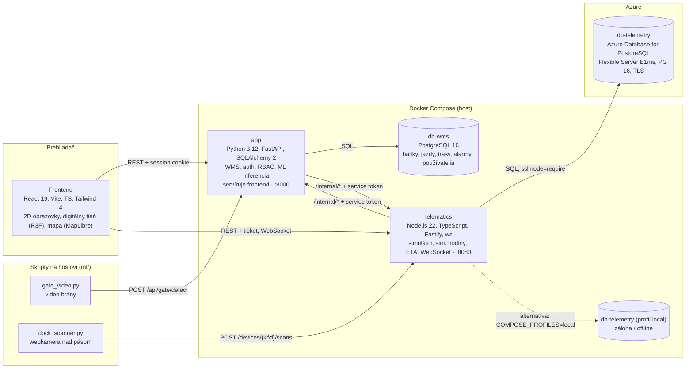
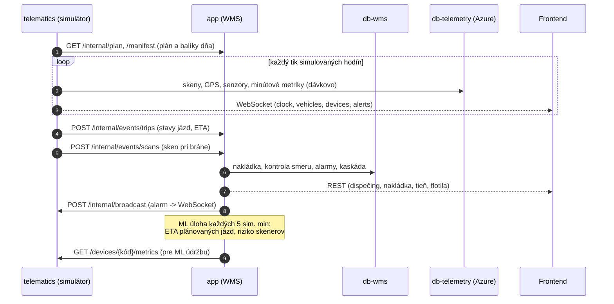
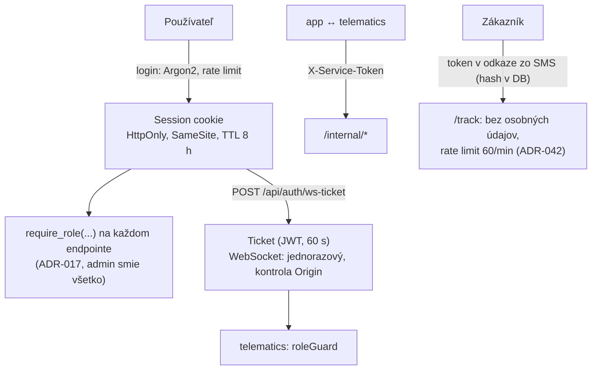

# Architektúra Depot 5.0

> Pre koho: tím, oponent a kto píše kapitolu o architektúre. Prehľad služieb, dátových tokov a bezpečnosti. Detaily rozhodnutí sú v [decisions.md](decisions.md) (ADR), endpointy v [api.md](api.md).

Depot 5.0 je prototyp WMS pre prekládkové depo Budimír pri Košiciach s hubom v Ivanke pri Dunaji. Proces depa je reálny, dáta sú simulované.

## Služby

| Služba | Úloha | Kde |
| --- | --- | --- |
| `app` | zdroj pravdy pre balíky, jazdy, trasy kuriérov a alarmy (ADR-022, ADR-041). Auth, RBAC, kontrola smeru pri nakládke, kaskáda, ML (meškanie, údržba skenerov, brána). Servíruje zostavený frontend | kontajner, port 8000 |
| `telematics` | simulované hodiny, deterministický simulátor (seed, ADR-023), poloha vozidiel, skeny, senzory, ETA, scenár „čo ak“, situácie a replay (ADR-053, 054), WebSocket | kontajner, port 8080 |
| `db-wms` | obchodné dáta (Alembic migrácie) | kontajner |
| `db-telemetry` | skeny, GPS, merania, minútové metriky, stav simulátora (číslované SQL migrácie, ADR-012) | **Azure** (predvolene), kontajner v profile `local` ako záloha (ADR-056) |

Jedna databáza je v Azure (požiadavka učiteľa). Kontajnery sú 3 a v offline režime 4, ďalšie (Redis, broker, Nginx) sa nepridávajú (PROMPT §1).

## Toky dát

- **Čas:** všetko beží v simulovanom čase telematiky (`GET /sim/clock`). Admin ho ovláda skokom, replayom a situáciami (ADR-025, 053, 054).
- **Determinizmus:** rovnaký seed dá rovnaký deň. Každé náhodné rozhodnutie má vlastný prúd `rngFor(seed, deň, …)`.
- **Scenár „čo ak“:** telematika prepočíta kópiu dňa tým istým kódom a do živých dát nič nezapíše (ADR-047).
- **ML** (ADR-057 až 060, [ml/README.md](../ml/README.md)):
  - predikcia meškania (HistGradientBoosting) plní ETA plánovaných jázd,
  - IsolationForest hodnotí skenery a pri riziku otvorí alarm,
  - brána rozpoznáva vozidlá (YOLOX) a ŠPZ (RapidOCR) na onnxruntime,
  - IoT skener na hostovi posiela skeny rovnakým API ako simulátor.
- **Digitálny tieň** (`/shadow`) zrkadlí realitu z WebSocketu a REST. Do fyzického sveta zasahuje len človek cez akcie WMS: presun jazdy, údržba, potvrdenie alarmu (ADR-045, 048).

## Bezpečnosť

- **Autentifikácia:** heslá sú hashované Argon2. Session je v cookie (HttpOnly, SameSite) a jej záznam v DB. Login má rate limit. Nebezpečné metódy z prehliadača kontroluje `Origin` (CSRF).
- **Autorizácia:**
  - o prístupe rozhoduje backend (`require_role`) a frontend len skrýva menu,
  - roly sú dispečer, operátor, ochranka, kuriér a admin,
  - ovládanie simulácie je len pre admina a v ostrom režime sa vypne (`SIM_CONTROLS_ENABLED=false`, ADR-053).
- **Medzi službami:** `X-Service-Token` na `/internal/*`. Prehliadač k telematike nemá session, dostane krátky ticket (ADR-027).
- **Súkromie:**
  - API tieňa a sledovania nevracia mená a adresy, kde ich rola nepotrebuje,
  - `/track` má token v hashi, `Cache-Control: no-store` a `Referrer-Policy: no-referrer`,
  - fotky z brány sa neukladajú, ŠPZ prejazdov sa po `GATE_RETENTION_DAYS` mažú (GDPR).
- **Tajomstvá** sú len v `.env` (v gite je `.env.example`). Spojenie s Azure DB je povinne cez TLS (`sslmode=require`, overený certifikát). Firewall servera povoľuje len zadané IP.
- **ML:** načítavajú sa len vlastné artefakty z repozitára (pickle je spustiteľný kód). Brána prijme obrázok najviac 8 MB a len od ochranky alebo admina.
