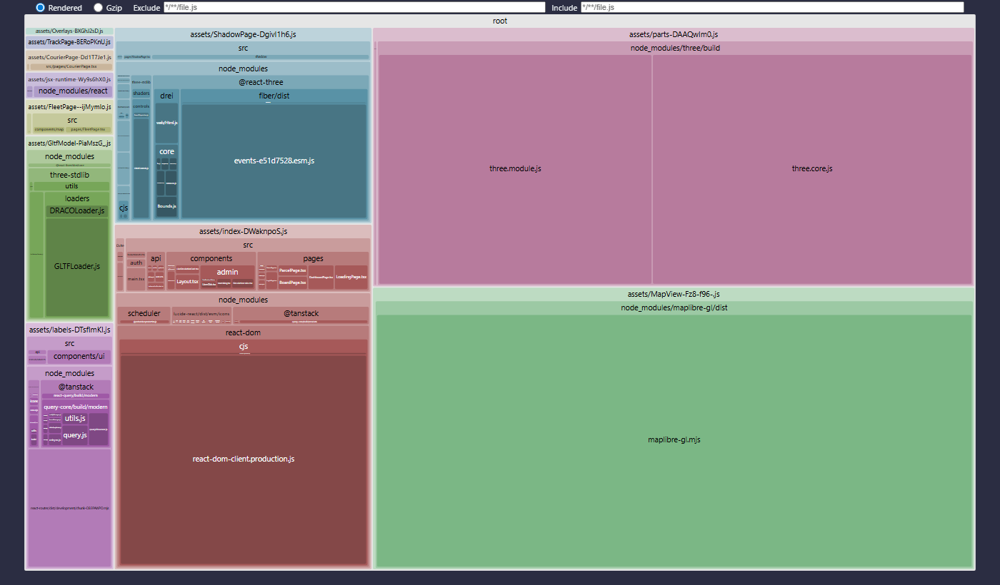

# Analýza bundlu frontendu

> Pre koho: kto mení závislosti frontendu alebo rieši rýchlosť načítania. Rozhodnutie je v ADR-046.

**Cieľ:** prihlasovacia stránka, dispečing a ostatné 2D obrazovky nesmú sťahovať three.js, React Three Fiber, drei ani MapLibre. Tie sa načítajú až pri otvorení Flotily (`/fleet`) alebo digitálneho tieňa (`/shadow`).

## Ako to zmerať

```bash
cd frontend
npm run analyze          # vite build --mode analyze
# výsledok: dist/stats.html (interaktívna mapa modulov, rollup-plugin-visualizer)
```



## Výsledok (Fáza 5c, 4. 11. 2026)

| Chunk | Kedy sa načíta | Obsah | Veľkosť | gzip |
| --- | --- | --- | --- | --- |
| `index` | vždy | React, React Router, TanStack Query, UI kit, lucide ikony, 2D obrazovky | 385 kB | 119 kB |
| `parts` | Flotila alebo tieň | **three.js** a spoločné 3D diely (`src/shadow/parts.ts`) | 744 kB | 190 kB |
| `ShadowPage` | `/shadow` | **React Three Fiber, drei, zustand, GLTFLoader**, scéna a panely | 346 kB | 108 kB |
| `MapView` | Flotila, sledovanie, kuriér | **MapLibre GL** | 1 078 kB | 293 kB |

- V hlavnom chunku (`index`) nie je three.js, R3F, drei ani MapLibre. Overené aj vyhľadaním `WebGLRenderer`, `useFrame` a `maplibre` v zostavených súboroch.
- three.js je v jednom zdieľanom chunku. Flotila (3D hala na mape) aj tieň ho používajú spoločne a prehliadač ho stiahne len raz.
- Od Fázy 5c sú v tieni modely Kenney (ADR-052), GLTFLoader je preto priamo v chunku `ShadowPage` a samostatný chunk `GltfModel` zanikol. Modely a textúry (`public/models`, ~0,65 MB) sa sťahujú len na `/shadow`. Kým sa načítajú, scéna ukazuje jednoduché tvary.
- Chunk `labels` sa od Fázy 5c zlúčil do `index` (Rollup ho už nevyčlenil). Spolu majú 385 kB, predtým 377 kB (297 + 80).
- Limit varovania `chunkSizeWarningLimit` je 1 800 kB kvôli MapLibre (lazy chunk).
