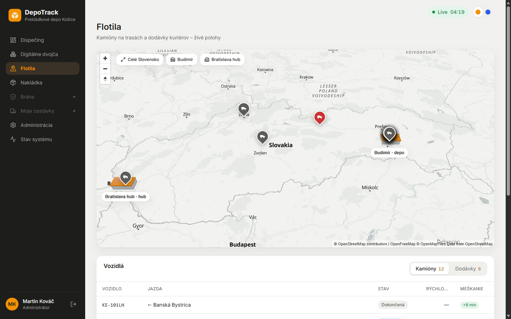
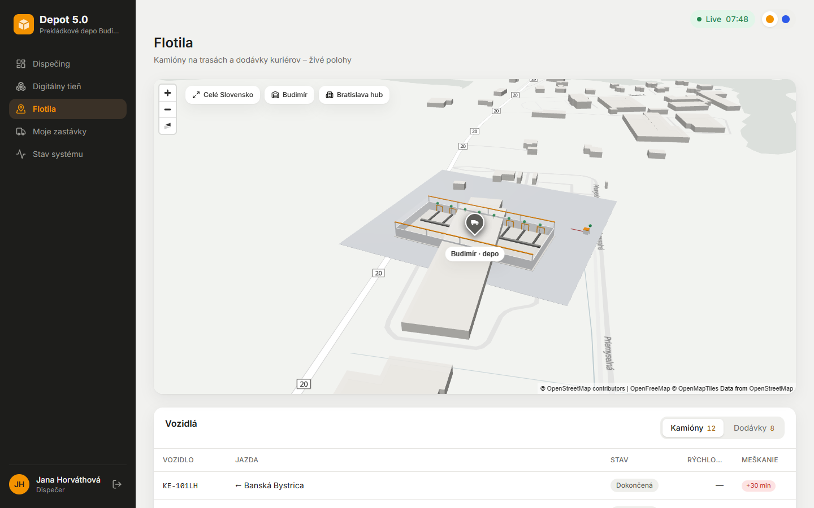
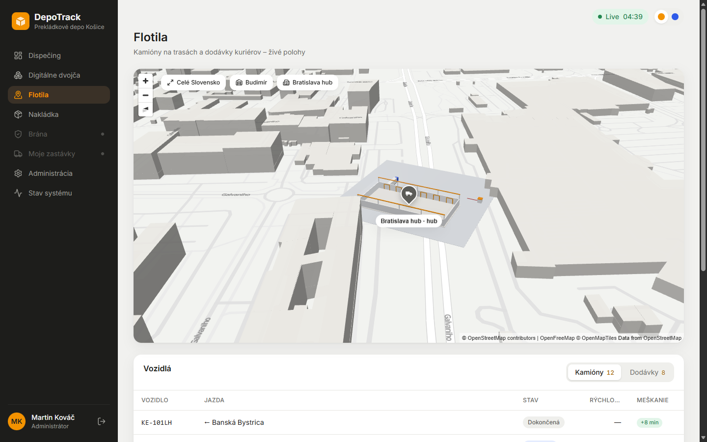
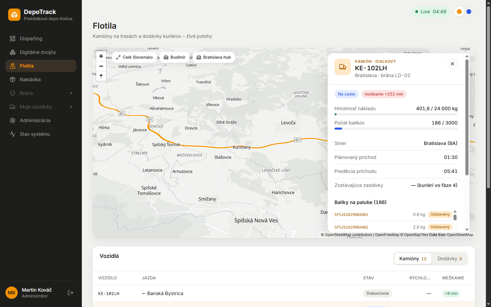

# Fáza 3b – mapa, sklady a reálne cesty

> Pre koho: členovia tímu a príprava na obhajobu. Čo vzniklo, kde to nájdeš a prečo je to tak.

## Čo vzniklo

| | |
| --- | --- |
|  |  |
| Celé Slovensko: depo Budimír a hub Bratislava ako 3D značky, kamióny ako piny | Priblížený Budimír: 3D hala z rozloženia (pás, brány, IoT piny, kamióny) |
|  |  |
| Hub Bratislava (jednoduchší model, rampy) | Vybraný kamión na D1 s trasou po reálnej ceste a bočným panelom |

1. **Mapa MapLibre GL:**
   - svetlý vektorový podklad OpenFreeMap, náklon 45° a 3D budovy,
   - vlastné piny podľa referencie s farbou podľa stavu a meškania,
   - trasa vybraného vozidla ako farebná čiara, plynulý prelet kamery,
   - tlačidlá „Celé Slovensko / Budimír / Bratislava hub“.
2. **Depo je v Budimíri**, nie v Košiciach. **Hub v Bratislave** je cieľom diaľkových kamiónov. Nová tabuľka `depots` a `depot_id` v dátovom modeli umožňujú ďalšie sklady.
3. **3D sklad na mape:**
   - Three.js vrstva v MapLibre z toho istého rozloženia, ktoré použije `/shadow` (`GET /api/layout?depot=BUD`),
   - pri priblížení hala, pás, brány, kamióny pri obsadených bránach, kopy balíkov a IoT piny so stavom,
   - pri oddialení výrazná 3D značka,
   - klik na sklad otvorí `/shadow?depot=…` (pred Fázou 5 `/twin`).
4. **Reálne cesty bez internetu za behu:** cestný graf z OpenStreetMap je v repozitári a telematika hľadá trasy algoritmom A*. Budimír → Bratislava hub je 423 km za 5,1 h po D1.
5. **Reálne adresy balíkov** z OSM (25 tisíc adresných bodov v Košiciach a ďalšie v cieľových mestách), vyberané deterministicky podľa seedu.

## Kde to je v kóde

| Čo | Súbor |
| --- | --- |
| Spracovanie OSM (graf, adresy) | [tools/osm/build_osm_data.py](../../tools/osm/build_osm_data.py), [tools/osm/README.md](../../tools/osm/README.md) |
| Routing A* | [telematics/src/simulator/roads.ts](../../telematics/src/simulator/roads.ts) |
| Trasy z plánu (depo + ciele smerov) | [telematics/src/simulator/routes.ts](../../telematics/src/simulator/routes.ts), `routesFor` v [index.ts](../../telematics/src/index.ts) |
| Depá, migrácia | [app/.../models/network.py](../../app/src/depotrack/models/network.py), [alembic/versions/*_depots.py](../../app/alembic/versions/) |
| Ciele smerov, rampy hubu, adresy | [app/.../seed/geo.py](../../app/src/depotrack/seed/geo.py) |
| API depá / rozloženie / stav | [app/.../api/depots.py](../../app/src/depotrack/api/depots.py) |
| Mapový komponent | [frontend/src/components/map/](../../frontend/src/components/map/) (`MapView`, `VehicleMarkers`, `RouteLine`, `DepotLayer`, `depot3d.ts`) |

## Prečo je to tak navrhnuté

- **Prečo offline graf, a nie routing API?** Zadanie zakazuje externé routing API a simulácia musí byť deterministická. Rovnaký graf dá vždy rovnakú trasu a nič sa nevolá cez internet. Graf má 1 MB a trasa sa nájde za ~30 ms.
- **Prečo stiahnutý výrez, a nie Overpass API?** Overpass bol pri vývoji preťažený (timeouty). Výrez z Geofabriku je spoľahlivý a reprodukovateľný a postup je opísaný v README.
- **Prečo `depots` ako tabuľka?** Hub je plnohodnotné miesto na mape s rozložením a bránami. Ďalší sklad je len nový riadok, nič sa neprepisuje v kóde.
- **Prečo rozloženie v DB (`layout`)?** 3D hala na mape a digitálny tieň vo Fáze 5 kreslia z tých istých dát, takže sa nemôžu rozísť.
- **Prečo MapLibre + Three.js?** MapLibre vie vektorové mapy, náklon a 3D budovy a cez „custom layer“ pustí do mapy vlastnú WebGL scénu. Three.js je štandard pre 3D v prehliadači a použije sa aj v `/shadow`.
- **Prečo sa mapa načítava zvlášť?** MapLibre a Three.js majú spolu ~1,6 MB. Hlavná aplikácia (~300 kB) ich načíta až pri otvorení mapy.

## Na overenie s tímom

- **Presná poloha a natočenie Budimíra a hubu:** zatiaľ ide o odhad podľa OSM. Úprava je jeden UPDATE v `depots` (`lat`, `lon`, `layout.hall.rotationDeg`).
- Podklad mapy potrebuje internet v prehliadači. Offline záloha (PMTiles) je naplánovaná vo Fáze 7.

## Možné otázky na obhajobe

- *Ako sa vypočíta čas jazdy?* Súčet úsekov trasy: dĺžka úseku delená rýchlosťou podľa triedy cesty (diaľnica 85 km/h, I. trieda 65 km/h, ulica 30 km/h …).
- *Čo sa stane, keď sa zmení poloha depa?* Pri ďalšom načítaní plánu dňa si telematika z grafu vypočíta nové trasy. Nič iné netreba meniť.
- *Odkiaľ sú adresy?* Z adresných bodov OpenStreetMap (`addr:street` + `addr:housenumber`). Dáta sú pod licenciou ODbL, atribúcia je na mape aj v README.
