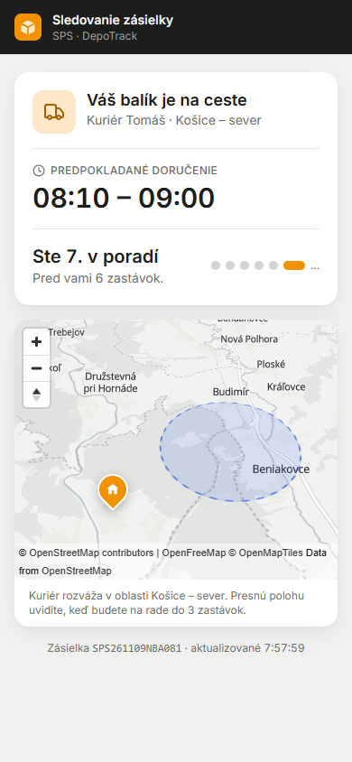
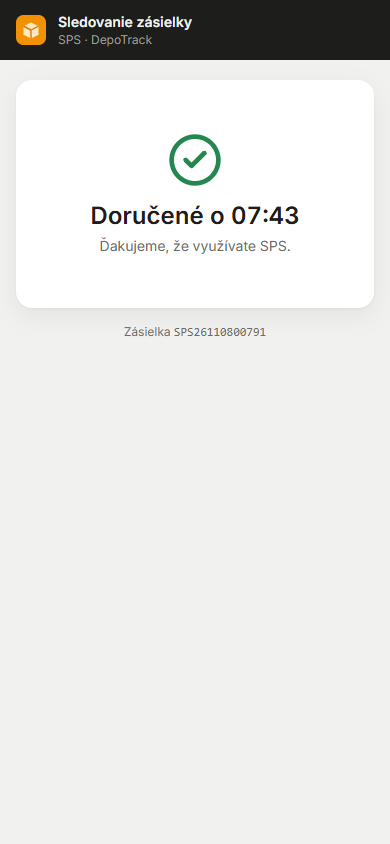
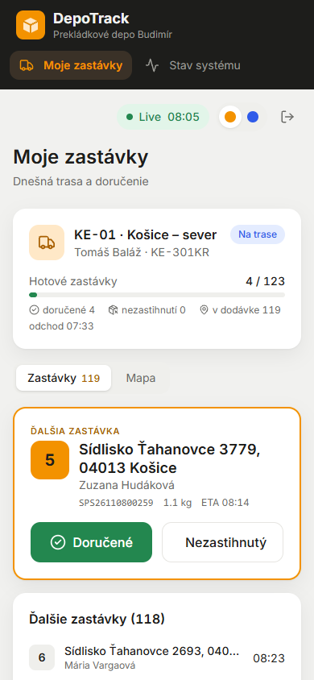
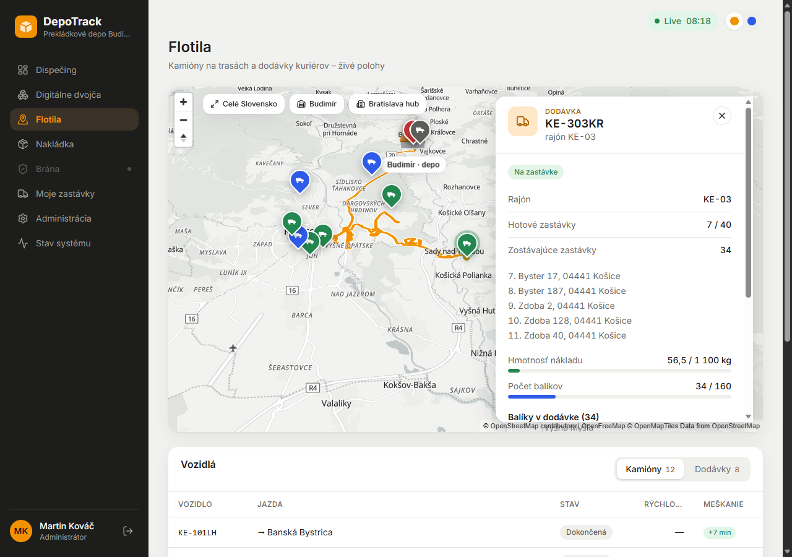
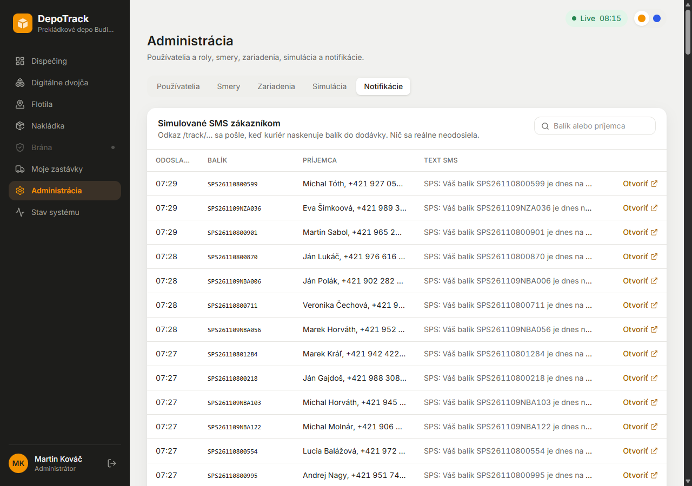

# Fáza 4 – zákazník a kuriér

> Pre koho: členovia tímu a príprava na obhajobu. Čo vzniklo, kde to nájdeš a prečo je to tak.

## Čo vzniklo

| | |
| --- | --- |
|  |  |
| `/track/<token>`: okno doručenia, poradie, približná oblasť kuriéra | Po doručení len „Doručené o HH:MM“, bez mapy |
|  |  |
| `/courier`: ďalšia zastávka a veľké tlačidlá | Dodávka vo Flotile: zvyšok trasy po uliciach a zostávajúce zastávky |

> Screenshoty sú zo stavu pred premenovaním (názov „DepoTrack“, menu „Digitálne dvojča“, SMS „SPS:“). Dnes je to „Depot 5.0“, „Digitálny tieň“ a „Depot 5.0: Váš balík DP…“ (ADR-044, ADR-045).

1. **Trasy kuriérov.**
   - Každý z 8 kuriérov má svoj rajón (KE-01 až KE-08), dodávku a odstavnú plochu.
   - App zoradí zastávky metódou *nearest neighbor* od depa Budimír.
   - Ráno od 7:00 kuriér naskenuje balíky do dodávky a okolo 7:30 vyrazí.
   - Dodávka jazdí po skutočných uliciach Košíc (offline graf, A\*) a na každej zastávke stojí 2–6 min.
   - 90 % doručení je úspešných.
2. **Sledovanie zásielky.**
   - Keď je balík naskenovaný v dodávke, app vytvorí tajný odkaz a „pošle“ zákazníkovi SMS.
   - Verejná stránka `/track/<token>` ukazuje:
     - stav,
     - okno doručenia (napr. 08:10 – 09:00),
     - „Ste 7. v poradí“,
     - mapu.
   - Obnovuje sa každých 5 s.
3. **Súkromie na serveri.**
   - Presnú polohu kuriéra uvidí len zákazník, ktorý je najviac 3. v poradí.
   - Ostatní vidia len rajón a kruh s polomerom 2 km.
   - Iné zastávky, adresy ani trasu nevidí nikto z verejnosti.
4. **Zneplatnenie.**
   - Po doručení odkaz ukáže už len „Doručené o HH:MM“.
   - O polnoci dňa doručenia odkaz prestane platiť úplne.
5. **Obrazovka kuriéra `/courier`.**
   - Mobile-first: ďalšia zastávka, tlačidlá „Doručené“ a „Nezastihnutý“, zoznam zastávok a mapa.
   - Dispečer a admin si môžu pozrieť trasu ktoréhokoľvek kuriéra.
6. **Admin → Notifikácie:** všetky simulované SMS s tlačidlom „Otvoriť“ (otvorí odkaz zákazníka).
7. **Flotila:** dodávky sa pohybujú, majú stav (nakladá / na trase / na zastávke / vracia sa) a vybraná dodávka ukáže zvyšok trasy.

## Ako to predviesť (2 minúty)

1. Admin → *Simulácia* → skok na **06:00** a rýchlosť napr. 30×.
2. Po 7:00 v *Notifikácie* pribúdajú SMS. Klikni na „Otvoriť“: stránka zákazníka ukáže „Balík je pripravený na doručenie“.
3. Po ~7:30 kuriér vyrazí. Pri zákazníkovi ďaleko v poradí je na mape len kruh. Keď sa poradie zníži na 3, objaví sa presná poloha dodávky.
4. Prihlás sa ako `kurier01` (na mobile) a klikni „Doručené“. Stránka zákazníka sa do 5 s zmení na „Doručené o HH:MM“.

## Kde to je v kóde

| Čo | Súbor |
| --- | --- |
| Trasy, nakládka do dodávky, uzavretie zastávky | [app/.../services/couriers.py](../../app/src/depotrack/services/couriers.py) |
| Token, SMS, verejný pohľad so súkromím | [app/.../services/tracking.py](../../app/src/depotrack/services/tracking.py) |
| Verejný endpoint (rate limit) | [app/.../api/track.py](../../app/src/depotrack/api/track.py) |
| API kuriéra, notifikácie | [api/courier.py](../../app/src/depotrack/api/courier.py), [api/notifications.py](../../app/src/depotrack/api/notifications.py) |
| Udalosti zo simulátora | `/internal/courier-routes`, `/internal/events/couriers` v [api/internal.py](../../app/src/depotrack/api/internal.py) |
| Simulácia jazdy kuriéra | [telematics/src/simulator/couriers.ts](../../telematics/src/simulator/couriers.ts), napojenie v `engine.ts` |
| Vyvážené rajóny | `kosice_rajon` v [seed/generator.py](../../app/src/depotrack/seed/generator.py) |
| Stránky | [TrackPage.tsx](../../frontend/src/pages/TrackPage.tsx), [CourierPage.tsx](../../frontend/src/pages/CourierPage.tsx), [NotificationsTab.tsx](../../frontend/src/components/admin/NotificationsTab.tsx) |
| Mapové doplnky (piny, kruh) | [components/map/Overlays.tsx](../../frontend/src/components/map/Overlays.tsx) |
| Testy | [app/tests/test_delivery.py](../../app/tests/test_delivery.py), [telematics/tests/couriers.test.ts](../../telematics/tests/couriers.test.ts) |

Rozhodnutia: ADR-041 (trasy a simulácia), ADR-042 (token a súkromie), ADR-043 (obrazovka kuriéra, dodávky vo Flotile).

## Prečo je to tak navrhnuté

- **Prečo sa ukladá len hash tokenu?** Kto ukradne databázu, nezíska funkčné odkazy, lebo SHA-256 sa nedá otočiť. Plný odkaz má len „odoslaná SMS“ (ADR-010), v reálnom svete log SMS brány.
- **Prečo `token_urlsafe(32)`?** 256 bitov náhody sa nedá uhádnuť ani bez limitu. Rate limit (pred Fázou 5: 10 neúspechov za minútu na IP, 60/min na platný odkaz, ADR-042) navyše bráni skúšaniu a zahlteniu.
- **Prečo rovnaká odpoveď 404 pre neznámy, expirovaný aj zrušený odkaz?** Útočník sa nedozvie, či odkaz niekedy existoval.
- **Prečo kruh, a nie presná poloha?** Zákazník, ktorý je ďaleko v poradí, nepotrebuje vedieť, kde presne kuriér je. Presná poloha by prezradila, kde sú iní zákazníci. Kruh je zaokrúhlený na mriežku, takže sa nedá „vystopovať“ pohyb.
- **Prečo súkromie na serveri?** Čo príde do prehliadača, si vie ktokoľvek prečítať. Keby filtroval frontend, údaje by boli v odpovedi API aj tak.
- **Prečo app pýta polohu od telematiky?** Telematika vlastní simuláciu a polohy vozidiel. App je zdroj pravdy pre balíky a trasy. Poloha sa cachuje 2 s.
- **Prečo jazdu kuriéra simuluje telematika, ale trasu robí app?** Rovnako ako pri kamiónoch: app plánuje (zdroj pravdy), telematika vykonáva a hlási. Simulácia je čistá funkcia seedu, takže deň je opakovateľný.
- **Prečo vyvážené rajóny?** Pri rovnakých 45° výsekoch mal jeden kuriér 3× viac zastávok (staré mesto je hustejšie) a vracal by sa večer.

## Možné otázky na obhajobe

- *Čo sa stane, keď kuriér klikne „Doručené“?* Zastávka sa uzavrie, balík je `delivered`, vznikne udalosť v histórii balíka a token dostane `revoked_at`. Stránka zákazníka ukáže len čas doručenia. Neskoršia správa zo simulátora pre tú istú zastávku sa ignoruje (platí prvý výsledok).
- *Ako viete, že je zákazník „4. v poradí“?* Spočíta sa, koľko neuzavretých zastávok je na trase pred jeho zastávkou, a pripočíta sa 1.
- *Ako sa počíta okno doručenia?* Predikcia ETA zo simulátora ± 10 minút pre najbližšiu zastávku, pri vzdialenejších až ± 30 minút, zaokrúhlené na 5 minút.
- *Môže zákazník zistiť adresy iných ľudí?* Nie. API vracia len jeho vlastné miesto doručenia a polohu kuriéra (presnú až od 3. miesta v poradí). Test `test_privacy_exact_position_only_for_next_three` to overuje.
- *Prečo platí odkaz do polnoci, a nie 24 hodín?* Zadanie chce tvrdú expiráciu na konci dňa. Ide o simulovaný čas, lebo celý systém beží v čase simulátora.
