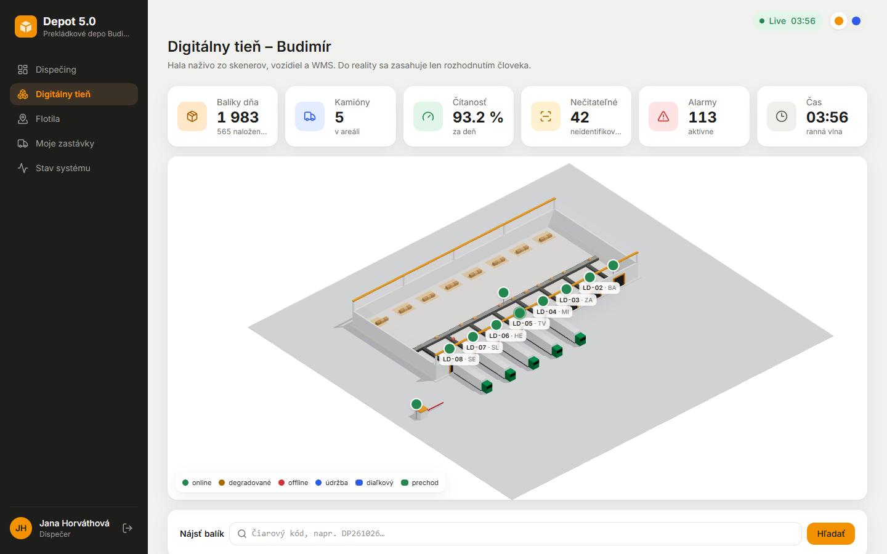
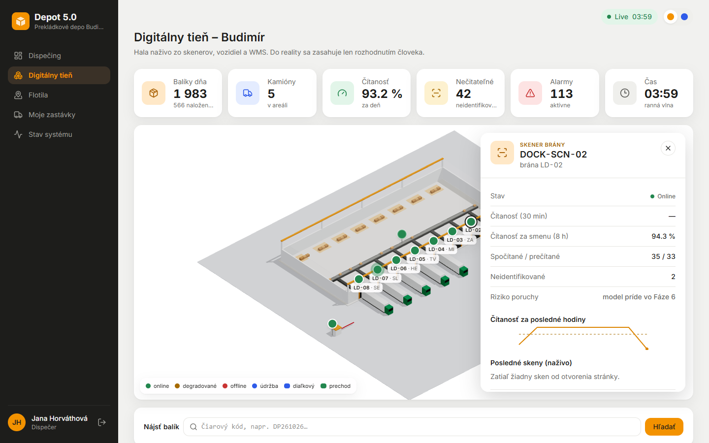
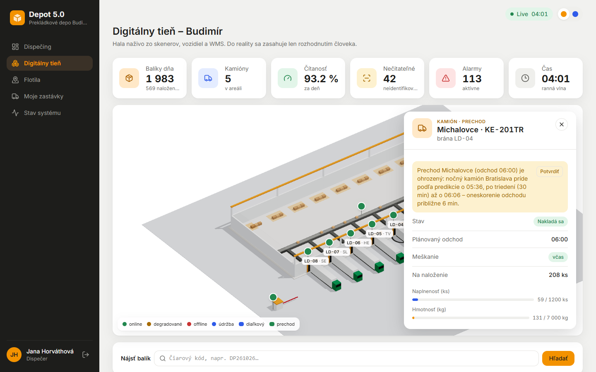
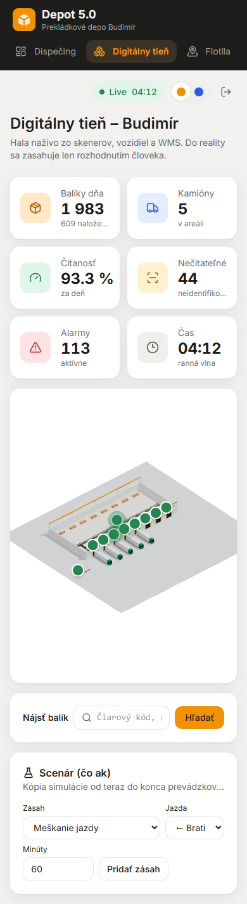

# Fáza 5 – digitálny tieň

> Pre koho: členovia tímu a príprava na obhajobe. Čo vzniklo, kde to nájdeš a prečo je to tak.

## Čo vzniklo

| | |
| --- | --- |
|  |  |
| `/shadow`: hala z rozloženia, kamióny pri bránach, piny zariadení, balíky na páse, KPI | Skener: posledné skeny naživo, čítanosť za smenu, sparkline, údržba |
|  |  |
| Kamión: naplnenosť (ks, kg), chýbajúce balíky, zlý smer, kaskáda, presun na inú bránu | 390 px: scéna, KPI a panely pod sebou |

1. **Digitálny tieň `/shadow` (zadanie §7).**
   - 3D scéna v React Three Fiber z `GET /api/layout`, nič nie je napevno v komponentoch.
   - Prvky scény:
     - hala, pás s odbočkami, brány,
     - kamióny pri obsadených bránach (farba podľa typu smeru, plynulý príjazd aj odchod),
     - kopy balíkov na odstavných plochách,
     - vjazd a autá na dvore.
   - Izometrická ortografická kamera, otáčanie len okolo zvislej osi, zoom s limitmi.
   - **IoT piny** (drei `Html`) majú farbu podľa stavu: online, degradované, offline a nový stav údržba (fialová). Pri každom skene krátko pulzujú.
   - **Balíky na páse:** každý sken pošle krabičku po páse k bráne, ktorá ho naskenovala (drei `Instances`, najviac 300 naraz). Nečitateľné sú červenkasté.
   - **Horná lišta KPI:**
     - balíky dňa (odchýlka: zadanie chce „balíky v aktuálnej vlne“, ale balík patrí prevádzkovému dňu, nie vlne. Počet za deň je zhodný s dispečingom),
     - kamióny v areáli,
     - čítanosť,
     - nečitateľné,
     - alarmy,
     - simulovaný čas.
   - **Panely po kliknutí:**
     - zariadenie (posledných 20 skenov naživo, čítanosť za 30 min a za smenu, spočítané/prečítané/neidentifikované, sparkline; skóre rizika príde vo Fáze 6),
     - kamión (smer, naplnenosť v ks a kg voči kapacite, chýbajúce balíky, alarmy zlého smeru, plánovaný odchod, kaskádové varovanie).
   - **Vyhľadanie balíka** podľa čiarového kódu s vodorovnou časovou osou. Ak je balík fyzicky v hale (pás, brána, odstavná plocha), scéna ho označí.
   - Funguje aj pre hub Bratislava (kamióny pri rampách).
2. **Scenár „čo ak“ (panel „Scenár“, len dispečer a admin).**
   - **Zásahy:**
     - meškanie jazdy,
     - výpadok zariadenia,
     - zmena čítanosti,
     - druhý skener na bránu,
     - presun jazdy na inú bránu.
   - Telematika prepočíta kópiu dňa od teraz do konca prevádzkového dňa. Je to okamžité, deterministické a bez zápisu do živých dát.
   - **Výsledok:**
     - tabuľka plán vs. scenár (meškanie prechodov, kaskádové varovania, neidentifikované balíky, zlé smery a z toho neodhalené),
     - zoznam dotknutých jázd (starý a nový čas),
     - červené krúžky okolo dotknutých brán a zariadení v scéne.
3. **Akcie WMS zo scény** (bežné API s RBAC, len dispečer a admin):
   - presun jazdy na inú bránu (kontrola obsadenosti, potom skenuje skener novej brány),
   - označenie zariadenia na údržbu (na chvíľu stav „údržba“, potom vyčistené),
   - potvrdenie alarmu (kaskáda v paneli kamióna, alarmy zariadenia).
4. **Pod kapotou:**
   - upgrade na React 19 (samostatný commit),
   - spoločné 3D diely pre tieň aj mapu,
   - spoločné testovacie prípady kaskády pre Python aj TypeScript,
   - analýza bundlu ([docs/bundle.md](../bundle.md)).

## Ako to predviesť (2 minúty)

1. Prihlás sa ako `dispecer` → **Digitálny tieň**. Počas večernej vlny (17:00–21:30) stoja kamióny pri bránach LD-01 až LD-03 a po páse idú balíky.
2. Klikni na pin **DOCK-SCN-02** (brána BA). Čítanosť za smenu klesá, lebo skener sa v predvolenom scenári špiní. Klikni **Označiť na údržbu**: pin zafialovie a po 20 simulovaných minútach je skener čistý.
3. V paneli **Scenár** pridaj *Meškanie jazdy* → „← Bratislava (príchod …)“ → 90 min a *Druhý skener na bránu* → LD-02. Klikni **Spustiť scenár**:
   - kaskádových varovaní a meškania prechodov pribudne (Michalovce, Humenné, Senica čakajú na Bratislavu),
   - neidentifikovaných balíkov ubudne,
   - v scéne sa rozsvietia dotknuté brány.
4. Prihlás sa ako `ochranka`: scénu aj panely vidí, panel Scenár ani tlačidlá akcií nie. Backend by akciu aj tak odmietol (403).

Odkazy na demo: `/shadow?depot=BUD&door=LD-02` otvorí panel kamióna, `&device=DOCK-SCN-02` panel zariadenia. `/shadow?depot=BAH` je hub.

## Kontrola výkonu (fps)

- **Cieľ:** 60 fps pri 1440 × 900 počas večernej vlny.
- **Nástroj:** Playwright 1.58 (Chromium, ANGLE/Direct3D 11, teda hardvérová GPU), skript [tools/fps/fps.mjs](../../tools/fps/fps.mjs) (návod v [tools/fps/README.md](../../tools/fps/README.md)).
  - Stránka `/shadow?depot=BUD&fps=1` prepne scénu na vykresľovanie každej snímky a `FpsProbe` (`src/shadow/FpsProbe.tsx`) každú sekundu zapíše počet vykreslených snímok do `window.__shadowFps` a do štítku v rohu scény.
  - Meria sa 20 sekúnd po 5 s zahriatí.
  - `?fps=stress` navyše plní pás syntetickými balíkmi (80 za sekundu, ~300 naraz na páse). Simulácia sa pri tom nemení.
- **Výsledok (26. 10. 2026, počítač vývojára, GPU NVIDIA GeForce RTX 4070 SUPER):**

  | Režim | Simulovaný čas | Priemer | Minimum |
  | --- | --- | --- | --- |
  | živé dáta (`fps=1`) | 19:38, večerná vlna | 60 fps | 60 fps |
  | plný pás (`fps=stress`) | 20:27, večerná vlna | 60 fps | 60 fps |

  60 fps je strop obnovovacej frekvencie. Cieľ je splnený s rezervou.
- V bežnom režime (`frameloop="demand"`) sa scéna nevykresľuje, keď sa nič nehýbe. Snímku si vyžiada zmena v store, pohyb kamery, prichádzajúci kamión, pulz pinu alebo balík na páse (`invalidate()` každý frame, kým sa niečo hýbe).
- **Obmedzenie:** meralo sa na výkonnej GPU, nie na „bežnom notebooku“ zo zadania. Pred obhajobou treba to isté zopakovať na notebooku, na ktorom sa bude prezentovať: `tools/fps/fps.mjs`, alebo otvoriť `/shadow?depot=BUD&fps=stress` a pozrieť štítok vľavo hore.

## Kde to je v kóde

| Čo | Súbor |
| --- | --- |
| Stránka, výber, zvýraznenie | [frontend/src/pages/ShadowPage.tsx](../../frontend/src/pages/ShadowPage.tsx) |
| Scéna, kamera, `frameloop="demand"` | [shadow/ShadowScene.tsx](../../frontend/src/shadow/ShadowScene.tsx), [shadow/CameraRig.tsx](../../frontend/src/shadow/CameraRig.tsx) |
| Malé 3D komponenty | [shadow/](../../frontend/src/shadow/): `Hall`, `Conveyor`, `Dock`, `Truck`, `DevicePin`, `ParcelFlow`, `YardCars`, `Highlight` |
| Spoločné 3D diely (tieň + mapa) | [shadow/parts.ts](../../frontend/src/shadow/parts.ts), mapa: [components/map/depot3d.ts](../../frontend/src/components/map/depot3d.ts) |
| Živé dáta (zustand) | [shadow/store.ts](../../frontend/src/shadow/store.ts), [shadow/useShadowFeed.ts](../../frontend/src/shadow/useShadowFeed.ts) |
| Panely (KPI, zariadenie, kamión, balík, scenár, akcie) | [shadow/panels/](../../frontend/src/shadow/panels/) |
| API tieňa (bez osobných údajov) | [app/.../api/shadow.py](../../app/src/depotrack/api/shadow.py) |
| Akcie (presun jazdy, údržba) | [app/.../api/actions.py](../../app/src/depotrack/api/actions.py), tabuľka [models/maintenance.py](../../app/src/depotrack/models/maintenance.py) |
| KPI dňa (dispečing aj tieň) | [app/.../services/kpis.py](../../app/src/depotrack/services/kpis.py) |
| Scenár čo ak | [telematics/src/simulator/whatif.ts](../../telematics/src/simulator/whatif.ts), skeny dňa: [dayevents.ts](../../telematics/src/simulator/dayevents.ts) |
| Údržba, oprava, znovunačítanie plánu | `startMaintenance`, `repair`, `refreshPlan` v [engine.ts](../../telematics/src/simulator/engine.ts) |
| Kaskáda v oboch jazykoch + spoločné prípady | [services/cascade.py](../../app/src/depotrack/services/cascade.py), [simulator/cascade.ts](../../telematics/src/simulator/cascade.ts), [contracts/cascade-cases.json](../../contracts/cascade-cases.json) |
| Testy | `app/tests/test_shadow.py`, `test_actions.py`, `test_cascade_contract.py`, `telematics/tests/whatif.test.ts`, `cascade-contract.test.ts` |

## Prečo je to tak navrhnuté

- **Prečo „tieň“, a nie „dvojča“?** Tieň realitu zrkadlí automaticky, ale do reality zasahuje len človek cez WMS. Dvojča by fyzické zariadenia riadilo priamo (ADR-045).
- **Prečo React Three Fiber, a nie Next.js?** App je za loginom (SSR nič neprinesie), WebGL scéna sa na serveri nevykreslí a Next.js server by bol 5. kontajner (ADR-046). R3F 9 potrebuje React 19, preto upgrade.
- **Prečo zustand a refy v `useFrame`?** Skeny chodia niekoľkokrát za sekundu. Keby každý menil React state, prekresľovala by sa celá stránka. Scéna si dáta berie zo store priamo v renderovacej slučke. Panely sa prihlásia na odber len svojho výseku.
- **Prečo `frameloop="demand"`?** Keď sa nič nehýbe, GPU nepracuje. Animácie (balíky, príjazd kamióna, pulz) si snímky vyžiadajú samy cez `invalidate()`, preto nezamrznú.
- **Prečo scenár nie je druhý simulátor?** Deň je deterministická funkcia vstupov. Stačí ho prepočítať so zmenenými vstupmi tým istým kódom. Je to rýchle, nič sa nezapisuje a výsledok je zakaždým rovnaký (ADR-047).
- **Prečo spoločné diely v čistom three.js?** Mapa je MapLibre vrstva bez Reactu. Spoločné funkcie (`parts.ts`) používa mapa aj R3F scéna, takže tvar sa mení na jednom mieste a mapa sa nemusela prepisovať (ADR-049).
- **Prečo API tieňa nevracia mená a adresy?** Tieň vidí aj ochranka a tá ich nepotrebuje. Súkromie sa filtruje na serveri.

## Možné otázky na obhajobe

- *Čo chýba k digitálnemu dvojčaťu?* Priame príkazy zariadeniam: zastaviť pás, prestaviť výhybku k bráne, reštartovať skener, otvoriť závoru. K tomu riadiaca vrstva (PLC/OPC UA, MQTT), bezpečnostné blokovania a potvrdenie vykonania (ADR-045).
- *Ako viete, že scenár nezmenil živé dáta?* Počíta sa na kópiách plánu a scenára a výsledok nikam nezapisuje. Test `whatif.test.ts` porovná dva enginy: jeden scenár spustil, druhý nie, a oba odohrajú večer s identickými skenmi.
- *Prečo je scenár deterministický aj pri zmene čítanosti?* Rovnaký seed a rovnaký počet náhodných ťahov na každý sken. Zmena čítanosti zmení len to, ktoré štítky sa prečítajú, nie ktoré balíky skončia pri zlej bráne.
- *Čo ak sa vzorec kaskády v Pythone a TypeScripte rozíde?* Oba overujú ten istý súbor prípadov v `contracts/cascade-cases.json`. Zmena jedného bez druhého zhodí test.
- *Čo sa stane s presunutou jazdou po reštarte dňa?* Reset dňa ju vráti na predvolenú bránu smeru, aby sa deň prehral rovnako (ADR-048).
- *Čo sa stane s balíkmi počas údržby skenera?* Skener neposiela skeny, takže balíky ostanú nenaložené, kým ich operátor nenaskenuje ručne na `/loading`. Po údržbe je skener čistý. Od ďalšieho dňa sa zase špiní, aby zaručený scenár degradácie ostal pre ML vo Fáze 6.
- *Prečo sa scenár počíta do konca prevádzkového dňa, a nie do konca vlny?* Kaskády vznikajú v noci. Pri horizonte do 22:00 by sa meškanie nočného kamióna vôbec neprejavilo.
- *Ako ste merali 60 fps?* Pozri časť Kontrola výkonu: Playwright, `FpsProbe`, 1440 px, večerná vlna, aj záťažový režim s plným pásom.
- *Prečo je three.js v samostatnom chunku?* Prihlasovacia stránka a 2D obrazovky ho nepotrebujú. Analýza bundlu je v `docs/bundle.md`.
