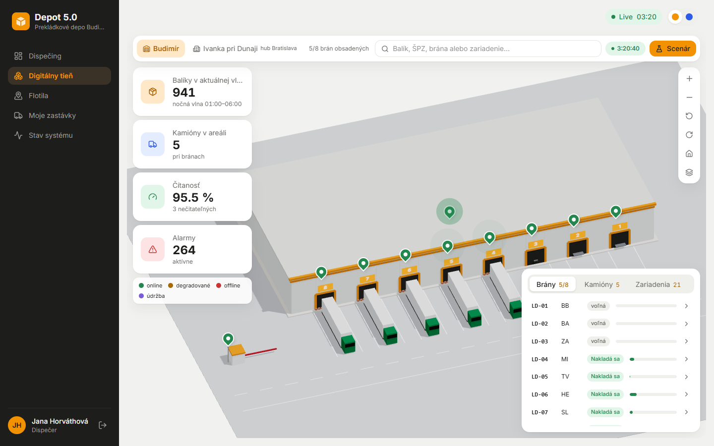
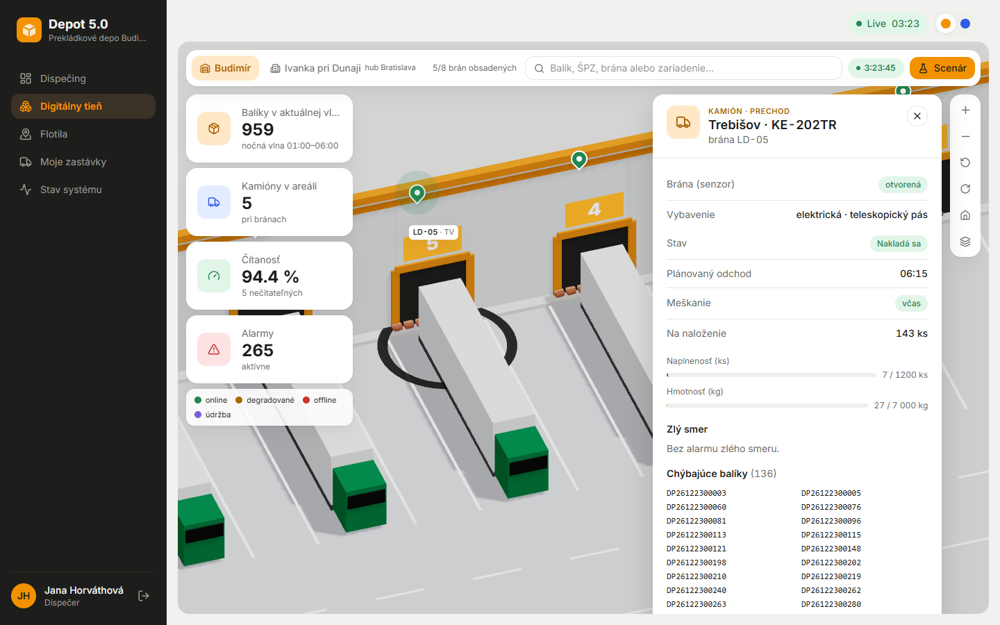
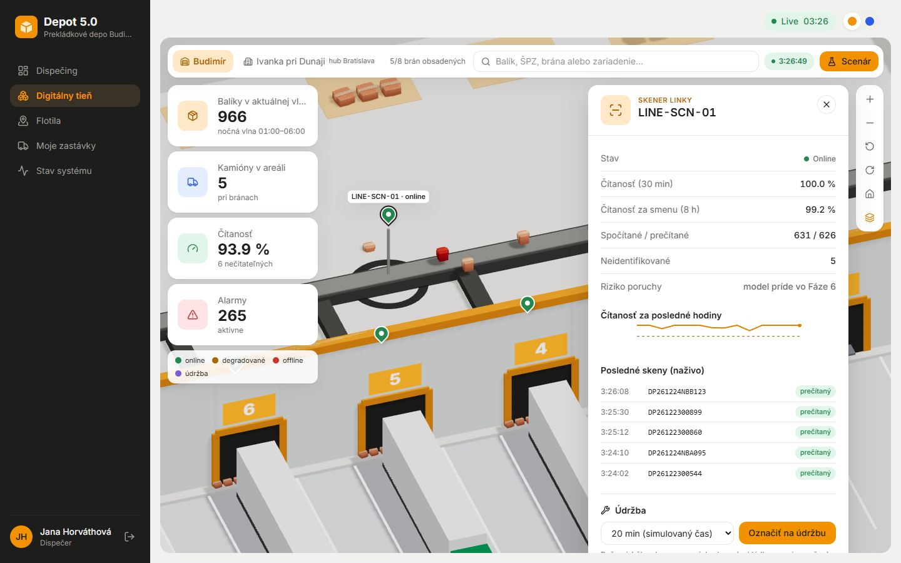
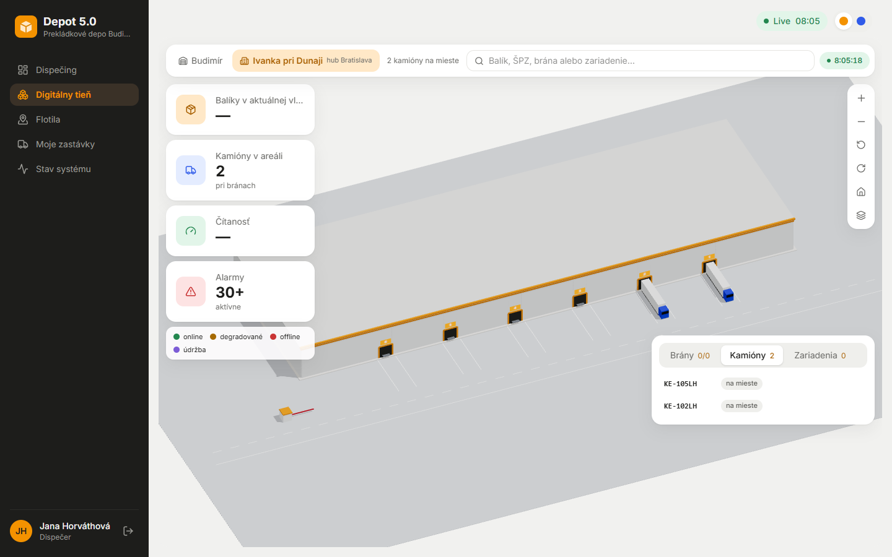
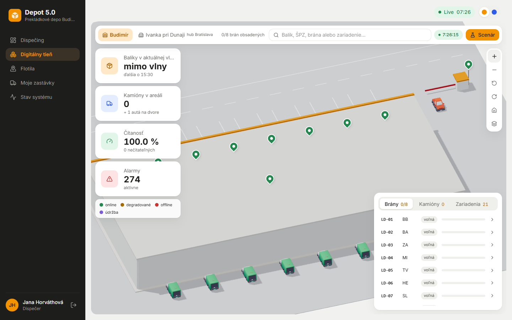
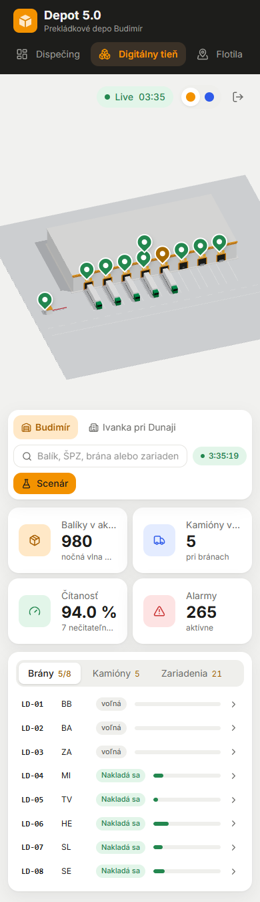

# Fáza 5c – digitálny tieň v2

> Pre koho: členovia tímu a príprava na obhajobe. Čo sa na tieni zmenilo po spätnej väzbe k Fáze 5, kde to nájdeš a prečo je to tak.

## Čo vzniklo

| | |
| --- | --- |
|  |  |
| Scéna cez celú plochu, plávajúce panely, nočná vlna s kamiónmi pri LD-04 až LD-08 | Panel kamióna: stav brány zo senzora, vybavenie brány, naplnenosť, chýbajúce balíky |
|  |  |
| Výber skenera odkryje strechu: krabice z Factory Kitu na páse, nečitateľný balík je červený | Hub `BAH` podľa budovy z OpenStreetMap (167 × 54 m), kamióny pri rampách aj v zozname |
|  |  |
| Ráno 07:26, kamera otočená k južnej stene: dodávky z Car Kitu pri odstavných plochách, auto z kitu pri vjazde | 390 px: scéna hore, lišta, KPI a zoznam pod sebou, bez vodorovného posunu |

Fáza mala štyri kroky, každý s vlastným commitom:

1. **Layout podľa referencie (5c-1)** ([docs/design/reference.png](../design/reference.png)).
   - 3D scéna je cez celú plochu, ostatné sú plávajúce panely nad ňou.
   - **Lišta tieňa:**
     - prepínač skladu s kontextom („5/8 brán obsadených“, „2 kamióny na mieste“),
     - vyhľadávanie balíka, ŠPZ, brány aj zariadenia,
     - živý simulovaný čas,
     - tlačidlo „Scenár“ (scenár je v draweri).
   - **KPI vľavo:**
     - balíky v aktuálnej vlne podľa `services/waves.py` (večerná 15:30–22:00, nočná 01:00–06:00, inak „mimo vlny · ďalšia o HH:MM“),
     - kamióny v areáli,
     - čítanosť,
     - alarmy.
   - **Vpravo dole** zoznam Brány / Kamióny / Zariadenia. Vpravo hore ovládanie kamery (zoom, otočenie, domov, strecha).
   - Odkazy vedú na `/parcels/:id`, `/fleet?plate=` a `/loading?door=`.
2. **Scéna v2 (5c-2).**
   - Kamera je zo strany dvora (~38°) a hala má plné steny a strechu.
   - Strecha sa odkryje tlačidlom alebo sama pri výbere zariadenia či nájdenom balíku.
   - Čísla brán sú na fasáde. Sekcionálne brány sa otvárajú a v otvorenej bráne sú balíky pri kamióne.
   - Dvor má státia, jazdný pruh a vjazd so závorou.
   - Piny majú tvar kvapky, popisok sa ukáže pri hoveri alebo výbere.
3. **Reálne brány (5c-3, ADR-050).**
   - Brána má `door_drive` (elektrická / ručná) a `dock_equipment` (mostík / teleskopický pás / bez vybavenia).
   - Dverové senzory `DOOR-SNS-01…08` hlásia otvorená / zatvorená / porucha.
   - **Stav brány v scéne aj v paneli je len zo senzora.** Pri poruche je brána neutrálna so štítkom „senzor – porucha“, stav sa nehádá podľa kamióna.
   - Senzor nevstupuje do čítanosti, minútových metrík ani dát pre ML (test).
4. **GLTF modely a hub (5c-4, ADR-051, ADR-052).**
   - Hub sa presunul do **Ivanky pri Dunaji** na budovu „Slovak Parcel Service | UPS“ z OSM (way 52070792). V UI má názov „Ivanka pri Dunaji“ s kontextom „hub Bratislava“, kód `BAH` ostal. Zmena je v migrácii aj v seede, takže čistá aj existujúca DB skončia rovnako.
   - Modely Kenney (CC0):
     - autá na dvore a kuriérske dodávky z Car Kitu 3.1,
     - balíky na páse a krabice v kôpkach z Factory Kitu 3.0, ako inštancie jednej geometrie.
   - Kamión ostal vlastný diel.
   - Kuriérske dodávky v stave „nakladá sa“ stoja pri svojej odstavnej ploche (ráno ~07:00–07:35).
   - Oprava: nedokončené jazdy zo starších prevádzkových dní (stack bol vypnutý) už neblokujú brány v tieni, na nakládke ani na mape Flotily.

## Ako to predviesť (2 minúty)

1. Prihlás sa ako `dispecer` → **Digitálny tieň**. Lišta ukazuje obsadenosť brán, KPI vľavo ukazuje aktuálnu vlnu. Počas večernej vlny (17:00–21:30) stoja kamióny pri LD-01 až LD-03, v noci (03:00–06:00) pri LD-04 až LD-08.
2. Klikni na kamión pri bráne. Panel ukáže **Bránu (senzor)** „otvorená“ a vybavenie brány (napr. „elektrická · teleskopický pás“). Brána je v scéne otvorená a v otvore sú krabice.
3. Klikni na pin skenera linky. Strecha sa odkryje a na páse idú krabice k bránam, nečitateľné sú červené.
4. Prepni sklad na **Ivanka pri Dunaji**. Hala má rozmery a natočenie budovy z OSM, záložka Kamióny ukazuje kamióny v hube.
5. Ráno 07:00–07:35 (admin: *Simulácia → skok na 06:00*, potom zrýchliť) otoč kameru tlačidlom „Otočiť doľava“ k južnej stene. Pri odstavných plochách stoja nakladané kuriérske dodávky.
6. Voliteľne: počas večernej vlny jeden dverový senzor vypadne. Brána je potom neutrálna so štítkom „senzor – porucha“ (Zariadenia → `DOOR-SNS-…`).

Odkazy na demo: `/shadow?depot=BUD&door=LD-05`, `&device=LINE-SCN-01`, `/shadow?depot=BAH`, `&fps=stress` (záťažový režim).

## Kontrola výkonu

Rovnaký postup ako vo Fáze 5 ([faza-5-digitalny-tien.md](faza-5-digitalny-tien.md#kontrola-výkonu-fps)). Pri 1440 × 900 v záťažovom režime (`?fps=stress`, ~300 balíkov na páse ako inštancie GLTF geometrie, kôpky, autá a dodávky z kitu) bol priemer aj minimum **60 fps**. Konzola bola bez chýb.

## Kde to je v kóde

| Čo | Súbor |
| --- | --- |
| Lišta, KPI, zoznam, ovládanie kamery, sledovanie balíka | [shadow/hud/](../../frontend/src/shadow/hud/) |
| Kamera (zaostrenie, domov, odkrytie strechy) | [shadow/CameraRig.tsx](../../frontend/src/shadow/CameraRig.tsx) |
| Brány, vybavenie, stav zo senzora | [shadow/Dock.tsx](../../frontend/src/shadow/Dock.tsx), panel [panels/TruckPanel.tsx](../../frontend/src/shadow/panels/TruckPanel.tsx) |
| GLTF modely, mierka, fallback | [shadow/models.ts](../../frontend/src/shadow/models.ts), [gltf.tsx](../../frontend/src/shadow/gltf.tsx), [useModelMesh.ts](../../frontend/src/shadow/useModelMesh.ts), [public/models/](../../frontend/public/models/) |
| Inštancie krabíc (pás, kôpky) | [shadow/ParcelFlow.tsx](../../frontend/src/shadow/ParcelFlow.tsx), [shadow/BoxPile.tsx](../../frontend/src/shadow/BoxPile.tsx) |
| Autá na dvore, kuriérske dodávky | [shadow/YardCars.tsx](../../frontend/src/shadow/YardCars.tsx), [shadow/CourierVans.tsx](../../frontend/src/shadow/CourierVans.tsx) |
| KPI vlny | [app/.../services/kpis.py](../../app/src/depotrack/services/kpis.py), [services/waves.py](../../app/src/depotrack/services/waves.py) |
| Vybavenie brán (DB) | migrácia `d4e8a2b6c1f3`, `DOOR_EQUIPMENT` v [seed/reference.py](../../app/src/depotrack/seed/reference.py) |
| Dverové senzory | [telematics/sql/006_door_sensors.sql](../../telematics/sql/006_door_sensors.sql), `updateDoors` v [engine.ts](../../telematics/src/simulator/engine.ts) |
| Hub z OSM | [tools/osm/find_hub.py](../../tools/osm/find_hub.py), migrácia `e7f1c3a9b5d2`, `HUB_*` v `seed/reference.py` |
| Aktívna jazda pri bráne | `active_trip_at` v [services/loading.py](../../app/src/depotrack/services/loading.py) |
| Testy | `app/tests/test_shadow.py` (aj hranice vĺn), `test_depots.py`, `telematics/tests/doors.test.ts`, `roads.test.ts` |

## Prečo je to tak navrhnuté

- **Prečo stav brány len zo senzora?** Tieň zrkadlí to, čo namerali senzory. Keby sa stav odvodzoval od kamióna, porucha senzora by sa skryla a dispečer by videl istotu, ktorú nemá. Neutrálna brána so štítkom hovorí „neviem“ poctivo (ADR-050).
- **Prečo má senzor vlastný náhodný prúd?** Porucha senzora nesmie zmeniť skeny, jazdy ani kaskádu. Test porovná deň so senzormi a bez nich a skeny sú rovnaké.
- **Prečo krabice ako inštancie, a nie klony?** Na páse je až 300 krabíc. Klon by bol samostatný objekt a draw call. `InstancedMesh` je jeden draw call pre všetky, preto ostáva 60 fps (ADR-052).
- **Prečo fallback na jednoduché tvary?** Chýbajúci alebo pomaly načítaný model nesmie rozbiť scénu. Error boundary a Suspense ukážu pôvodný diel z `parts.ts`.
- **Prečo kamión nie je z kitu?** Car Kit nemá ťahač s návesom v našej mierke. Vlastný diel má farby témy a zdieľa ho aj mapa.
- **Prečo hub z OSM a nie odhad?** Poloha a rozmery sú overiteľné (skript `find_hub.py` vypíše kandidátov). Našla sa práve jedna budova SPS, inak by sa hub nemenil bez rozhodnutia tímu (ADR-051).
- **Prečo migrácia aj seed?** Čistý klon a existujúca databáza musia skončiť rovnako. Overené testom z čistého klonu.

## Možné otázky na obhajobe

- *Čo ak senzor brány vypadne práve počas nakládky?* Brána sa zobrazí neutrálne so štítkom „senzor – porucha“. Nakládka (skeny) beží ďalej, lebo senzor do nej nevstupuje.
- *Riadi tieň bránu?* Nie. Senzor len hlási stav. Otváranie brány by bolo krokom k digitálnemu dvojčaťu (ďalší rozvoj, ADR-045).
- *Prečo „balíky v aktuálnej vlne“ a nie balíky dňa?* Dispečer riadi vlnu, nie kalendárny deň. Vlny sú na jednom mieste (`services/waves.py`) a test overuje hranice 15:29, 15:30, 22:00, 01:00, 06:00 a 10:00.
- *Aké licencie majú modely?* CC0 (Kenney). Názov, verzia a URL kitu sú v `frontend/public/models/LICENSE.txt`.
- *Koľko modely pridali do stiahnutia?* ~0,65 MB modelov a textúr, načítajú sa len na `/shadow`. GLTFLoader je v chunku tieňa, prihlasovacia stránka ho nesťahuje (docs/bundle.md).
- *Prečo sa po niekoľkých dňoch vypnutia brány zdali obsadené?* Staré nedokončené jazdy sa brali ako aktívne. Každá odchodová jazda dňa D naloží aj odíde v rámci dňa D (15:00 D až ~06:30 D+1). Preto `active_trip_at` aj mapa Flotily berú len jazdy aktuálneho prevádzkového dňa. Test má súčasne starú jazdu z predošlého dňa aj dnešnú a sken sa zapíše k dnešnej.
