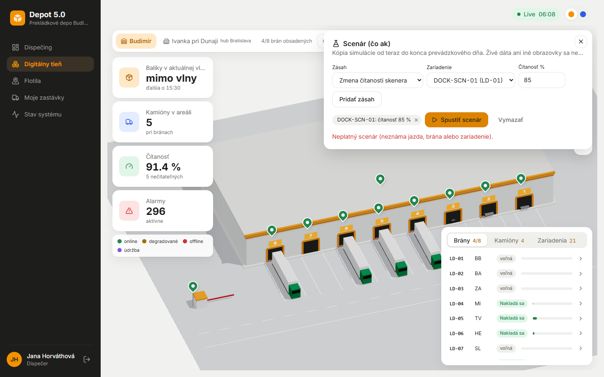

# Fáza 5d, krok 0 – diagnóza scenára „čo ak“

> Pre koho: tím a podklad pre krok 4 (oprava scenára). Len zistenia, nič sa neopravovalo.

## Ako sa meralo (5. 11. 2026)

- Živý stack, seed 42, prevádzkový deň 2026-12-27. Časy 10:00, 15:45, 18:30, 02:00 a 05:45 cez skok hodín (režim „preskočiť“).
- V každom čase skript zastavil hodiny a zavolal `POST /sim/what-if` ako admin. Jazdy a zariadenia vybral dvoma spôsobmi:
  - ako panel (prvý kandidát zo zoznamu `ScenarioPanel.tsx`),
  - „rozumne“ (najbližšia budúca jazda každého druhu).
- Panel v prehliadači overený Playwrightom (chybové hlásenia, kandidáti v zozname).
- Skripty a surové JSON výsledky ostali v scratchpade, nie sú v repozitári.

KPI scenára: meškanie prechodov (min), oneskorené prechody, kaskádové varovania, neidentifikované, zlé smery, z toho neodhalené. Plán (bez zásahu) mal vo všetkých časoch od 15:45 do 05:45 rovnaké hodnoty: **105 min, 5 z 5 prechodov oneskorených, 4 kaskády**.

## Výsledky

| Čas | Zásah | Očakávané | Skutočné | Príčina |
| --- | --- | --- | --- | --- |
| všetky | **Zmena čítanosti** (`read_rate`, DOCK-SCN-02 aj LINE-SCN-01) | neidentifikované ↑ | **400**, panel: „Neplatný scenár (neznáma jazda, brána alebo zariadenie)“ | **Chyba validácie:** Fastify AJV má predvolene `removeAdditional: true`. V `oneOf` sa telo najprv porovná so schémou `device_outage` (`additionalProperties: false`), tá z neho **vymaže `rate`**, a potom nesedí žiadna schéma. Reprodukované v izolovanom Fastify. |
| všetky | **Presun jazdy** (`move_trip`) | jazda na novej bráne, iný skener | **400** | Ten istý mechanizmus: pri porovnaní so schémou `extra_scanner` (alebo `delay`) sa z tela vymaže `tripId` alebo `doorCode`. |
| všetky | zásah `read_rate` alebo `move_trip` v zozname s ďalšími zásahmi | ostatné zásahy sa prepočítajú | celý scenár 400 | Validuje sa celé pole naraz. |
| — | testy | mali chybu zachytiť | prešli | `whatif.test.ts` volá `read_rate` a `move_trip` len priamo cez engine. Cez HTTP testuje `delay` a neplatné `read_rate` (rate 2), ktoré vráti 400, ale z iného dôvodu. |
| 10:00 | meškanie, presun | výber jazdy, alebo jasná správa „žiadne budúce jazdy“ | zoznam jázd je prázdny, „Pridať zásah“ neaktívne, bez vysvetlenia | Horizont je od teraz do 15:00 a v ňom nie je žiadna jazda. Panel horizont neopisuje a ďalší deň neponúka. |
| 10:00 | výpadok DOCK-SCN-02, -05, LINE-SCN-01, druhý skener LD-02 | zmena, alebo „v horizonte nie sú skeny“ | všetky KPI 0 → 0, „Časy jázd sa nemenia“ | V horizonte (10:00–15:00) nie sú žiadne skeny. Výsledok vyzerá ako „scenár nefunguje“. |
| 15:45 | meškanie +90 regionálneho návratu (TV, MI) | dopad na večerné nakladanie | len riadok „TV ← +90“, KPI bez zmeny (aj pri +300) | KPI nemerajú večerné diaľkové odchody ani balíky, ktoré nestihnú odchod. Regionálny návrat do žiadneho KPI nevstupuje. |
| 15:45, 18:30 | meškanie +90 večerného diaľkového odchodu (BB 20:30) | meškanie odchodu viditeľné v KPI | len riadok „BB → +90“, KPI bez zmeny | KPI meškania počíta **len prechody** (`directionType === "transit"`). V 18:30 je to navyše **predvolená voľba panelu** (prvý kandidát). |
| 15:45, 18:30 | meškanie +90 nočného BB (01:00) | kaskády ↑ | bez zmeny KPI | **Správne:** príchod 02:30 + 30 min triedenie je ~3 h pred odchodom SL, MI a TV. Panel ale rezervu neukáže, takže to pôsobí ako chyba. Pri +240 sa kaskády zvýšili 4 → 6 a meškanie 105 → 126. |
| 15:45 | meškanie +90 nočného ZA, rovnako o 02:00 | kaskády ↑ | bez zmeny | **Správne,** rezerva ~3,5 h (rovnako ako BB). |
| 15:45–05:45 | meškanie +60 / +90 / +240 nočného BA (zaručená porucha) | meškanie aj kaskády ↑ | meškanie 105 → 343 / 463 / 1063, kaskády **ostanú 4**, oneskorené **ostanú 5** | Kaskády: všetky 4 dvojice s BA sú ohrozené už v pláne, ukazovateľ nemá kam rásť. Oneskorené prechody: pozri ďalší riadok. |
| všetky | „Oneskorené prechody“ | citlivý ukazovateľ | v pláne vždy **5 z 5** | Odchod prechodu má náhodné prevádzkové meškanie (`departureDelay` v `scenario.ts`) a KPI počíta ako oneskorený každý odchod `> 0 min`. Ukazovateľ je v pláne nasýtený. |
| 02:00 | meškanie nočného BA −120 | kaskády ↓ | kaskády 4 → 0, meškanie 105 → 48, oneskorené **5 → 5** | Kaskády fungujú. Oneskorené ostanú nasýtené náhodným meškaním (predchádzajúci riadok). |
| 15:45–05:45 | meškanie +90 prechodu (SL, MI) | meškanie ↑ | meškanie +90 min presne, oneskorené bez zmeny | Výpočet je správny, ukazovateľ „oneskorené“ je nasýtený. |
| 02:00 | predvolená voľba panelu (BB, už pri bráne) | výsledok | prázdny výsledok, malá poznámka „Jedna zo zmenených jázd už prebehla“ | Zoznam ponúka jazdy, ktoré nie sú `departed`/`completed`, teda aj tie, čo už prišli. Prvá v zozname je udalosť z minulosti. |
| 02:00 | nočný BA v zozname | vybrať ho a uvidieť kaskádu | je v zozname ako „← Bratislava (príchod 01:30)“, hoci v skutočnosti príde ~06:05 | Popis ukazuje plánovaný čas, nie predikciu. Dispečer nevie, že ide o meškajúci kamión. |
| 15:45, 18:30, 05:45 | výpadok DOCK-SCN-02 / -05 / LINE-SCN-01 | neidentifikované ↑ | 101 → 296 / 237 / 1442 (15:45), podobne neskôr | **Funguje.** |
| 02:00, 05:45 | výpadok DOCK-SCN-02, druhý skener LD-02 | zmena, alebo vysvetlenie | 0 → 0 | **Správne:** brána BA v noci nenakladá. Panel ale nepovie, že v horizonte na tej bráne nie sú skeny. |
| 15:45, 18:30 | druhý skener LD-02 | neidentifikované ↓ | 101 → 70, 78 → 61 | **Funguje.** |
| 05:45 | presun jazdy | výber jazdy | zoznam prázdny (všetky prechody už nakladajú), bez vysvetlenia | Presúvať sa dá len `planned` alebo `at_door`. Je to správne pravidlo, ale chýba správa. |
| všetky | výpadok + druhý skener na tej istej bráne | — | výpadok vyhrá (1 − (1 − 0)² = 0) | Správne. |

*06:08, panel Scenár: platný zásah „DOCK-SCN-01: čítanosť 85 %“ skončí hláškou „Neplatný scenár (neznáma jazda, brána alebo zariadenie)“. Na zábere je aj 296 aktívnych alarmov (krok 5).*

## Zhrnutie príčin

1. **Chyba (blokuje 2 z 5 typov zásahov):** `read_rate` a `move_trip` cez API nikdy neprejdú. Príčinou je `oneOf` spolu s `removeAdditional` vo Fastify AJV. Panel to hlási ako „neznáma jazda, brána alebo zariadenie“. Testy HTTP cestu týchto dvoch typov nepokrývajú.
2. **Nasýtené a chýbajúce KPI:**
   - „oneskorené prechody“ sú v pláne vždy 5/5, lebo počítajú aj náhodné prevádzkové meškanie,
   - kaskády s BA sú už v pláne všetky ohrozené, takže meškanie BA ukáže len súčet minút,
   - meškanie večerných diaľkových odchodov a regionálnych návratov nevstupuje do žiadneho KPI.
3. **Horizont a prázdne výsledky:**
   - mimo vĺn (10:00) nie je v horizonte nič a panel to nepovie,
   - výsledok „0 → 0“ nevysvetlí, že zariadenie alebo brána v horizonte nemá skeny,
   - ďalší deň sa ponúknuť nedá.
4. **Výber v paneli:**
   - predvolený kandidát môže byť jazda, ktorá už prebehla, alebo jazda, ktorej meškanie žiadne KPI nemeria,
   - pri meškajúcom kamióne chýba predikovaný čas,
   - pri prázdnom zozname chýba vysvetlenie,
   - neukazuje sa rezerva do odchodu závislých prechodov, takže správne „bez kaskády“ vyzerá ako chyba.
5. **Funguje správne:** výpadok zariadenia, druhý skener, meškanie prechodu (minúty) a meškanie nočného kamióna nad rezervu (kaskády ↑ aj ↓). Výpočet na kópii (`runWhatIf`) je v poriadku. Problém je validácia API, výber KPI a UI.

## Návrh pre krok 4 (na schválenie spolu s krokom 4)

- **Validácia:** rozlíšiť zásahy podľa `kind` (`if/then` alebo `discriminator`), bez `oneOf` nad `additionalProperties: false`. HTTP test pre každý typ zásahu.
- **KPI:**
  - oneskorený prechod = meškanie nad toleranciu (napr. 15 min),
  - pridať meškanie diaľkových odchodov,
  - pridať balíky, ktoré nestihnú odchod,
  - kaskády ukazovať aj ako „max. meškanie ohrozeného odchodu“.
- **Panel:**
  - zoznam len budúcich udalostí s predikovaným časom,
  - pri jazde ukázať rezervu do závislých odchodov,
  - pri prázdnom horizonte správa a „horizont ďalšieho dňa“,
  - pri 0 → 0 vysvetlenie „v horizonte nie sú skeny na …“.
