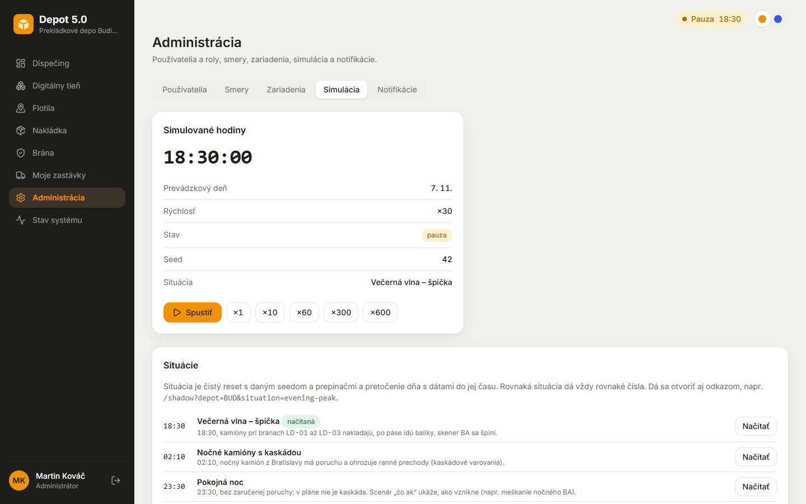

# Fáza 5d – Simulácia a testovanie (skrátená pred odovzdaním)

> Pre koho: tím a príprava na obhajobe. Čo sa zmenilo v ovládaní simulácie, prečo a čo ostalo na neskôr. Diagnóza scenára „čo ak“ je v [faza-5d-diagnoza.md](faza-5d-diagnoza.md).

## Čo vzniklo

1. **Hotfix scenára „čo ak“.** Zmena čítanosti a presun jazdy cez API vždy vracali 400 (Fastify AJV s `oneOf` a `removeAdditional`). Validácia sa teraz rozlišuje podľa `kind` a každý typ zásahu má HTTP test. Oneskorený prechod je až nad 15 min (`WHATIF_LATE_THRESHOLD_MIN`).
2. **Ovládanie času** (ADR-053):
   - skok na ľubovoľný čas v režime **„preskočiť“** (bez dát) alebo **„pretočiť s dátami“** (replay: každá simulovaná minúta so skenmi, prejazdmi a alarmami, celý deň za ~20 s),
   - krok +5 / +15 / +60 min (ten istý kód ako replay),
   - **čistý reset dňa**,
   - `SIM_CONTROLS_ENABLED=false` ovládanie vypne (403).
3. **Situácie** (ADR-054): `evening-peak`, `night-cascade`, `calm-night` (bez kaskády v pláne), `morning-departures`, `couriers-morning`, `scanner-ld05`, `off-wave`.
   - Načítanie je jedným klikom v admine, cez API alebo odkazom `?situation=…` (s potvrdením).
   - Rovnaká situácia dá rovnaké čísla (test aj naživo).
4. **Hygiena alarmov:** staré alarmy jázd a balíkov sa pri novom dni uzavrú (ostanú v histórii) a KPI ráta len aktuálny deň (z 296 na 10).
5. **Po review:**
   - pri dávkovom posielaní ide sken do app vždy pred „odišla“ svojej jazdy,
   - jeden mutex chráni replay, reset, seed aj situáciu (409),
   - replay počká na načítanie nového dňa a pri výpadku app sa zastaví s chybou 503.
6. **Na neskôr** ([plan-doplnky.md](../plan-doplnky.md), časť „Po odovzdaní“):
   - incidenty v živej simulácii,
   - zvyšok opravy scenára „čo ak“ (výber s predikciou, rezerva, nové KPI, horizont ďalšieho dňa, golden testy),
   - e2e Playwright.

## Ako to predviesť (1 minúta)

*Administrácia → Simulácia:*
1. *Situácie → Večerná vlna – špička* (~4 s).
2. Potom *Krok +15 min*: výsledok ukáže dosimulované minúty a počet skenov.
3. *Čistý reset dňa* vráti deň na 15:00 so seedom z `.env`.

## Kde to je v kóde

| Čo | Súbor |
| --- | --- |
| Replay, krok, čistý reset, mutex | `Engine.advance`, `cleanReset`, `loadSituation` v [telematics/src/simulator/engine.ts](../../telematics/src/simulator/engine.ts) |
| API | [telematics/src/api/sim.ts](../../telematics/src/api/sim.ts) (`/sim/clock/jump`, `/step`, `/sim/reset`, `/sim/situations`) |
| Situácie | [telematics/data/situations.json](../../telematics/data/situations.json), [simulator/situations.ts](../../telematics/src/simulator/situations.ts) |
| Reset v app, hygiena alarmov | [services/operating_day.py](../../app/src/depotrack/services/operating_day.py), [services/alerts.py](../../app/src/depotrack/services/alerts.py) |
| Admin UI, odkaz na situáciu | [components/admin/SimulationTabs.tsx](../../frontend/src/components/admin/SimulationTabs.tsx), [components/SituationLoader.tsx](../../frontend/src/components/SituationLoader.tsx) |
| Testy | `telematics/tests/replay.test.ts`, `situations.test.ts`, `whatif.test.ts` (HTTP každého zásahu), `app/tests/test_wms.py` |

## Prečo je to tak navrhnuté

- **Prečo replay namiesto snímky stavu?** Deň je predpočítaný, takže prebehnúť minúty tým istým kódom je presné a dosť rýchle (meranie v ADR-053). Snímka by bola ďalší stav, ktorý treba udržiavať.
- **Prečo sú situácie v telematike?** Telematika vlastní hodiny, seed aj prepínače scenára a admin UI ju volá priamo s ticketom (ADR-054).
- **Prečo uzatvárať, a nie mazať staré alarmy?** Audit: vidno, čo sa stalo, len to už neruší KPI.

## Možné otázky na obhajobe

- *Ako viete, že replay dá to isté ako živé hodiny?* Test porovná skeny, dáta pre app aj stavy jázd medzi replayom a behom po minútach. Ďalší test overí, že žiadny sken nepríde do app po odchode svojej jazdy.
- *Čo ak sa situácia načíta dvakrát?* Dá rovnaké čísla (test na čistom aj použitom engine).
- *Čo urobí `SIM_CONTROLS_ENABLED=false`?* Všetky ovládacie endpointy vrátia 403 aj so service tokenom a admin UI ovládanie skryje. Scenár „čo ak“ ostane, lebo nič nezapisuje.
