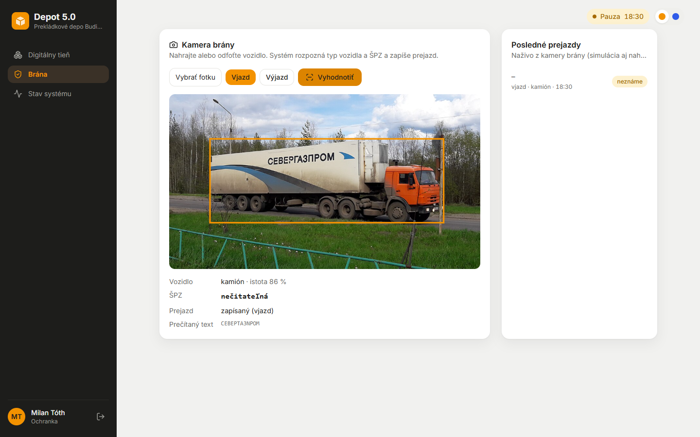
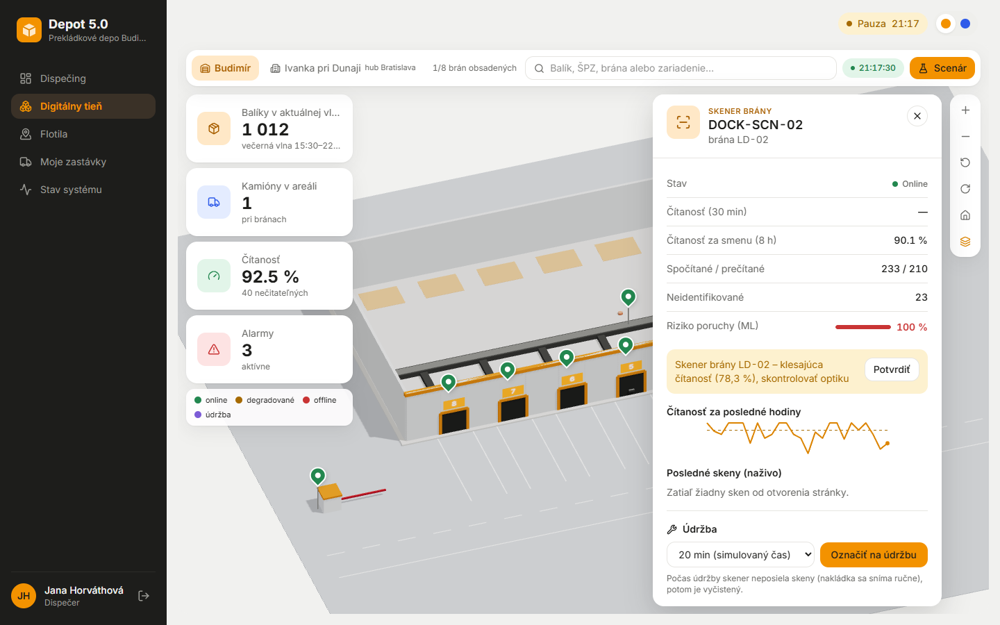
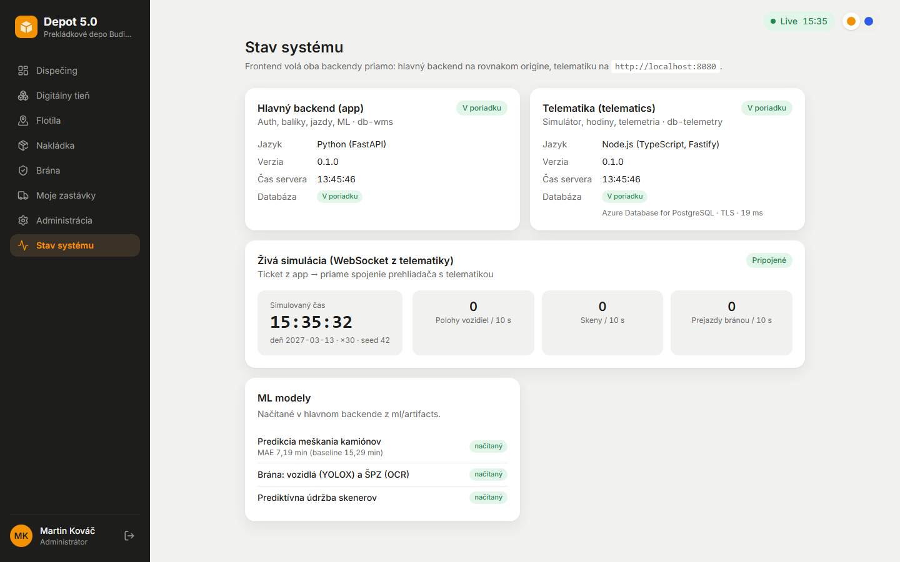
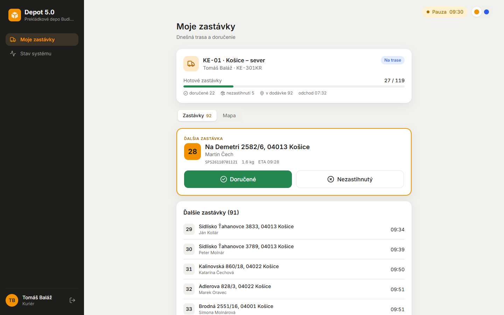

# Fáza 6 – Machine learning

> Pre koho: členovia tímu a príprava na obhajobe. Čo vzniklo, kde to nájdeš a prečo je to tak. Podrobnosti k dátam, príznakom a metrikám (pre kapitolu dokumentácie) sú v [ml/README.md](../../ml/README.md).

## Čo vzniklo

| | |
| --- | --- |
|  |  |
| `/gate`: YOLOX našiel kamión, OCR hľadá slovenskú ŠPZ, prejazd sa zapíše | Tieň o 21:10: skener BA (LD-02) má riziko 100 % a alarm „skontrolovať optiku“ |
|  |  |
| `/system`: db-telemetry v Azure (TLS, latencia), ML modely načítané s metrikou | `/courier` po oprave poradia zastávok (5b) |

Poradie časti zodpovedá priorite zo zadania. Každá má vlastný commit.

1. **Predikcia meškania kamiónov** (PROMPT §8.3, ADR-057).
   - `HistGradientBoostingRegressor` na 400 dňoch histórie zo simulátora.
   - Príznaky: smer, druh jazdy, deň v týždni, mesiac, hodina, počasie, meškanie včera.
   - **MAE 7,2 min oproti 15,3 min** pri baseline (priemer na smer).
   - Úloha v app každých 5 simulovaných minút doplní ETA plánovaným príjazdom (`predicted_by = ml`) a prepočíta kaskádu. Počas jazdy má prednosť ETA telematiky z polohy.
2. **Prediktívna údržba skenerov** (§8.4, ADR-058).
   - `IsolationForest` nad 10-minútovými bucket-mi čítanosti (z-skóre za 30 min a 2 h), dverové senzory vylúčené.
   - V teste zachytí **12 z 12 epizód** pri 0,49 % falošných alarmov.
   - **Zaručenú degradáciu zo seedu chytí v jej prvej večernej vlne** (test aj naživo).
   - Riziko je v paneli zariadenia v tieni, alarm „klesajúca čítanosť, skontrolovať optiku“.
3. **Brána (CV)** (§8.1, ADR-059).
   - YOLOX-Tiny (Apache-2.0) a RapidOCR na onnxruntime, bez torch a bez AGPL.
   - Dodávku od kamióna odlíši MobileNetV2 (ImageNet) na výreze vozidla, lebo COCO má pre obe jednu triedu.
   - Slovenská ŠPZ sa overí regexom s opravou zámen OCR.
   - `POST /api/gate/detect` zapíše prejazd a neznáma ŠPZ spustí alarm.
   - Obrazovka `/gate` pre ochranku, `ml/gate_video.py` pre video.
4. **IoT skener na nakládke** (§8.2, ADR-060).
   - `ml/dock_scanner.py` (webkamera, OpenCV) počíta krabice prechodom cez čiaru, číta QR a čiarové kódy a posiela skeny rovnakým API ako simulátor.
   - `ml/labels.py` vytlačí štítky reálnych balíkov dňa.
5. **Spoločné:**
   - artefakty sú v `ml/artifacts` a všetko sa pretrénuje jedným príkazom (`sh ml/train_all.sh`),
   - bez artefaktu app naštartuje a UI ukáže „model nedostupný“,
   - licencie sú v `ml/artifacts/LICENSES.md`.

## Ako to predviesť (2 minúty)

1. `/system`: ML modely *načítaný*, telemetria v Azure.
2. Admin: situácia `evening-peak`, potom *Skočiť 21:10, Pretočiť s dátami*. V tieni klik na pin DOCK-SCN-02: riziko 100 % a alarm skontrolovať optiku.
3. Situácia `calm-night`: dispečing ukáže ETA nočných kamiónov ešte pred odjazdom (z modelu). `GET /api/ml/delay/trips/{id}` vráti príznaky aj predikciu.
4. Ochranka na `/gate`: nahrať fotku vozidla alebo vytlačenú ŠPZ (napr. `KE-102LH` = vozidlo flotily, `ZA-999XY` = alarm).
5. Voliteľne IoT skener s krabicami (scenár v [docs/demo.md](../demo.md), krok 12).

## Kde to je v kóde

| Čo | Súbor |
| --- | --- |
| Tréning (v image app) | [ml/train_delay.py](../../ml/train_delay.py), [ml/train_scanner.py](../../ml/train_scanner.py), [ml/train_all.sh](../../ml/train_all.sh) |
| História zo simulátora | [telematics/src/scripts/gen-history.ts](../../telematics/src/scripts/gen-history.ts) |
| Príznaky a modely (zdieľané s tréningom) | [app/.../ml/delay.py](../../app/src/depotrack/ml/delay.py), [ml/scanner.py](../../app/src/depotrack/ml/scanner.py), [ml/gate.py](../../app/src/depotrack/ml/gate.py) |
| ML ETA a údržba skenerov | [services/ml_eta.py](../../app/src/depotrack/services/ml_eta.py), [services/ml_scanner.py](../../app/src/depotrack/services/ml_scanner.py), úloha `ml_job` v [jobs/scheduler.py](../../app/src/depotrack/jobs/scheduler.py) |
| API | [api/ml.py](../../app/src/depotrack/api/ml.py) (`/api/ml/status`, `/delay/trips/{id}`, `/scanners`), [api/gate.py](../../app/src/depotrack/api/gate.py), telematika `POST /internal/gate/passages` |
| Frontend | [pages/GatePage.tsx](../../frontend/src/pages/GatePage.tsx), riziko v [shadow/panels/DevicePanel.tsx](../../frontend/src/shadow/panels/DevicePanel.tsx), [components/MlModelsCard.tsx](../../frontend/src/components/MlModelsCard.tsx) |
| Skripty na hostovi | [ml/gate_video.py](../../ml/gate_video.py), [ml/dock_scanner.py](../../ml/dock_scanner.py), [ml/labels.py](../../ml/labels.py) |
| Testy | `app/tests/test_ml.py` (načítanie, inferencia cez HTTP, degradácia zo seedu, kódovanie dňa), `test_gate.py`, `telematics/tests/gate.test.ts` |

## Prečo je to tak navrhnuté

- **Prečo sa trénuje v image app?** Modely scikit-learn sa ukladajú ako pickle a spoľahlivo ich načíta len rovnaká verzia knižnice. Tréning v image app a jeden modul na kódovanie príznakov vylučujú rozdiel medzi tréningom aj inferenciou (ADR-057).
- **Prečo IsolationForest len na zdravých dátach?** Zadanie chce detekciu anomálií. Model sa naučí, ako vyzerá zdravý skener, a epizódy degradácie sa použijú len na vyhodnotenie. Z-skóre zohľadní, že pri ~1 položke za minútu je nízka čítanosť z pár balíkov len šum (ADR-058).
- **Prečo YOLOX a nie Ultralytics YOLO?** Ultralytics je AGPL-3.0, takže pri prevádzke ako služba by sme museli zverejniť kód celej aplikácie. YOLOX a RapidOCR sú Apache-2.0 a bežia na onnxruntime bez torch (ADR-059).
- **Prečo skener bez YOLO na krabice?** Nemáme označené snímky. Pri pevnej kamere a krabiciach za sebou stačí odčítanie pozadia a dotrénovanie je ďalší rozvoj (ADR-060).
- **Prečo app číta metriky skenerov cez telematiku?** db-telemetry je v Azure a app k nej nemá prístup. Telematika metriky už posiela pre sparkline v tieni (ADR-056, 058).

## Možné otázky na obhajobe

- *Ako viete, že model meškania niečo vie?* Na posledných 30 dňoch (december aj so snehom), ktoré nevidel, má MAE 7,2 min oproti 15,3 min, ak by sme predpovedali priemer smeru. Pri odjazdoch je zlepšenie menšie, lebo ich meškanie je hlavne náhodné.
- *Učíte sa na simulovaných dátach, čo to dokazuje?* Že reťazec dáta → tréning → inferencia → ETA a kaskáda funguje. Na reálnych dátach SPS by sa model pretrénoval tým istým skriptom.
- *Prečo prvá verzia nevedela o snehu?* História pokrývala máj až november. Review to odhalilo a teraz má 400 dní s pevným koncom a test mení vždy len jeden príznak.
- *Koľko falošných alarmov dá údržba skenerov?* 0,49 % zdravých 10-min bucket-ov, teda pri 8 skeneroch zhruba 1 za deň. Alarm vyžaduje 2 bucket-y po sebe a zatvára sa s hysteréziou.
- *Čo ak model chýba?* App naštartuje a `/system` aj panel ukážu „model nedostupný“. ETA potom dáva len telematika a brána vráti 503.
- *Je brána presná?* Na CC0 fotke návesu nájde kamión s istotou 0,86, Ford Transit aj dodávku kuriéra označí ako dodávku a syntetickú ŠPZ prečíta s istotou 0,96. Na reálnych fotkách z brány SPS to overené nie je.
