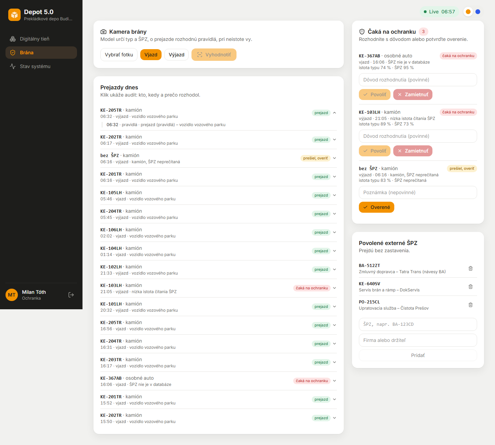
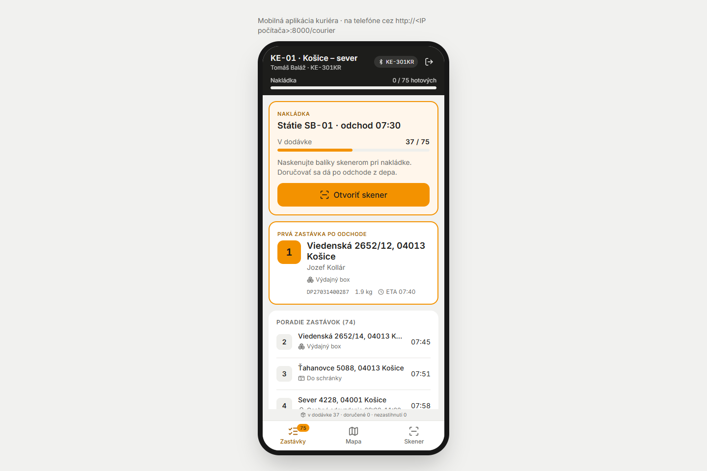
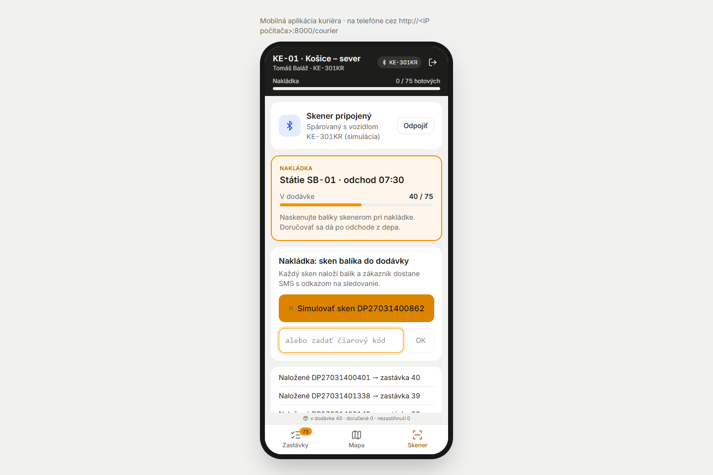
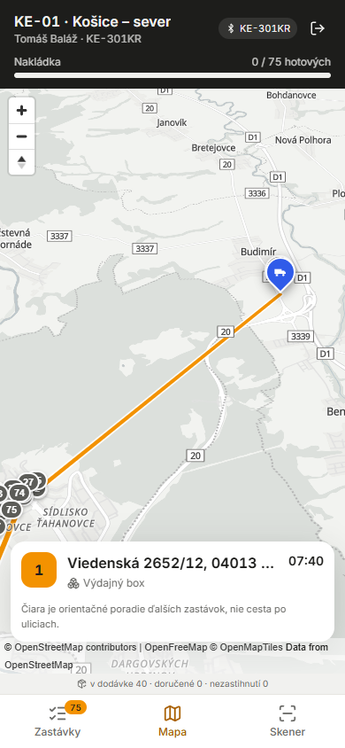
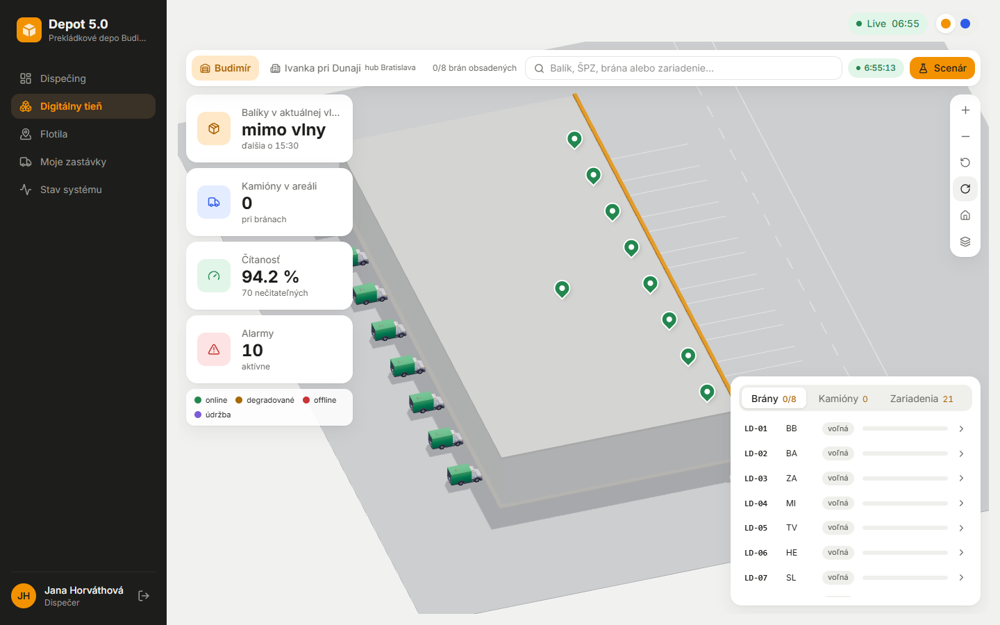
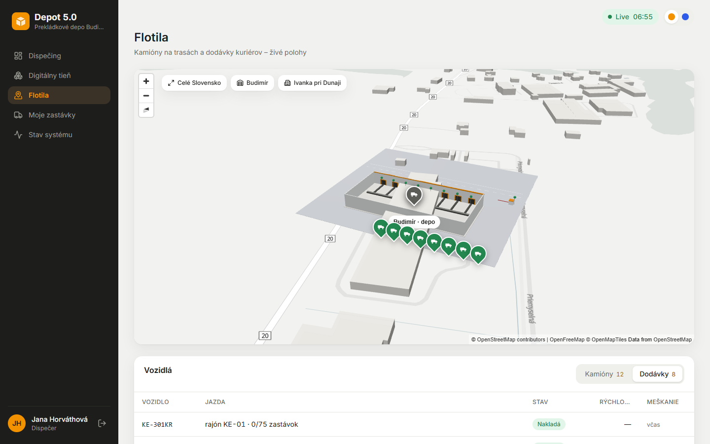

# Fáza 7b – Demo: brána, kuriérska appka, dispečeri, ranná nakládka

> Pre koho: tím a príprava na obhajobe. Posledné úpravy pred odovzdaním: čo vzniklo, kde to je v kóde, prečo je to tak a čo ostalo na neskôr. Rozhodnutia sú v ADR-061 (brána), ADR-062 (kuriér) a ADR-063 (ranná nakládka, dispečeri).

## Čo vzniklo

| | |
| --- | --- |
|  |  |
| `/gate`: front „Čaká na ochranku“, prejazdy dňa s auditom, povolené externé ŠPZ | `/courier` v ráme telefónu: nakládka pri SB-01, prvá zastávka s typom doručenia |
|  |  |
| Skener spárovaný s KE-301KR: sken naloží balík, zákazník dostane SMS | Mapa pri 390 px: ďalšia zastávka a orientačné poradie |
|  |  |
| Tieň o 06:56: dodávky stoja za odstavnými plochami pri južnej stene | Flotila: dodávky v rade v areáli, stav „Nakladá“ |

1. **Brána: model odporúča, pravidlá rozhodujú, pri neistote ochranka** (ADR-061).
   - Obraz určí typ a text ŠPZ. Identitu vozidla určí ŠPZ v databáze (vozový park alebo povolené externé ŠPZ).
   - Bez vozidla na zábere alebo pri nízkej istote rozhodne ochranka. Osobné auto so ŠPZ flotily sa zastaví.
   - Vozidlá flotily a povolené ŠPZ prejdú. Kamión s neznámou alebo neprečítanou ŠPZ prejde s príznakom „overiť“. Iné neznáme vozidlo čaká na ochranku (povoliť / zamietnuť s dôvodom).
   - Každé rozhodnutie je v audite (kto, kedy, prečo). Simulátor posiela mix prejazdov: kamióny, dodávky kuriérov, povolené externé vozidlo, občas neznámy kamión a ŠPZ s nízkou istotou.
   - Vyhodnotenie modelu na našich obrázkoch a obmedzenia sú v [ml/README.md](../../ml/README.md) (`ml/eval_gate.py`).
2. **Kuriér: mobilná appka** (ADR-062).
   - Na telefóne na celú obrazovku, na PC v ráme 390 × 844. Spodná navigácia: Zastávky, Mapa, Skener.
   - Pred odchodom ukazuje nakládku (státie, odchod, x / N v dodávke), nie neaktívne „Doručené“.
   - Simulovaný Bluetooth skener spárovaný s dodávkou: od 6:30 do odchodu sken naloží balík, po odchode vyberie zastávku a ukáže ju na mape.
   - Typ doručenia pri balíku: osobné odovzdanie s 3 h oknom (60 %), schránka (25 %), výdajný box (15 %). Appka ukazuje „stihneš / nestihneš okno“.
   - Poradie zastávok: time-oriented nearest neighbour. Na všetkých 648 trasách zmešká 0,2 % okien (Fáza 4: 59 %), za cenu +82 % km a dlhších trás (`tools/measure_routes.py`).
   - Appka sa otvorí na telefóne v rovnakej Wi-Fi na `http://<IP PC>:8000/courier` bez úprav `.env` ([demo.md](../demo.md)).
3. **Dispečeri:** `dispecer` (ranná), `dispecer2` (poobedná), `dispecer3` (nočná zmena), heslo z `SEED_DISPATCHER_PASSWORD`. Zmena je v admine v zozname používateľov a dá sa upraviť.
4. **Ranná nakládka:**
   - kuriéri nakladajú od 6:30 pri odstavných plochách, odchod ostáva okolo 7:30,
   - každá dodávka má vlastné miesto v areáli a stav „zaparkovaná“ cez noc aj po návrate, v tieni aj na mape Flotily,
   - situácia `couriers-morning` je o 06:55.
5. **Na neskôr** ([plan-doplnky.md](../plan-doplnky.md), „Po odovzdaní“):
   - layouty skladov vrátane Žiliny (bod 5),
   - kratšie trasy kuriérov pri oknách.

## Ako to predviesť (3 minúty)

1. *Admin → Simulácia → Situácie → Kuriéri ráno* (06:55). `/fleet` a `/shadow`: dodávky stoja v areáli a nakladajú sa.
2. `kurier01` na telefóne alebo v ráme na PC: nakládka x / 75, *Skener → Simulovať sken* (zákazník dostane SMS, je v *Admin → Notifikácie*). Po 7:30 sken balíka otvorí mapu so zastávkou.
3. `ochranka` na `/gate`: front má neznáme auto a kamión bez ŠPZ. Zamietnuť s dôvodom a kliknúť na prejazd, ukáže sa audit. Nahrať fotku vozidla alebo vytlačenú ŠPZ: tabuľka bez vozidla neotvorí bránu.
4. `admin` → *Používatelia*: traja dispečeri so zmenami.

## Kde to je v kóde

| Čo | Súbor |
| --- | --- |
| Pravidlá brány, audit, povolené ŠPZ | [services/gate.py](../../app/src/depotrack/services/gate.py), [api/gate.py](../../app/src/depotrack/api/gate.py), [models/gate.py](../../app/src/depotrack/models/gate.py) |
| Mix prejazdov simulátora | [telematics/src/simulator/gatemix.ts](../../telematics/src/simulator/gatemix.ts), posielanie `forwardGate` v [engine.ts](../../telematics/src/simulator/engine.ts), app `POST /internal/events/gate` |
| Poradie zastávok, typy doručenia | [services/routing.py](../../app/src/depotrack/services/routing.py), [services/couriers.py](../../app/src/depotrack/services/couriers.py), meranie [tools/measure_routes.py](../../tools/measure_routes.py) |
| Skener, appka kuriéra | `POST /api/courier/scan` v [api/courier.py](../../app/src/depotrack/api/courier.py), [pages/CourierPage.tsx](../../frontend/src/pages/CourierPage.tsx) |
| CSRF pre LAN | [core/csrf.py](../../app/src/depotrack/core/csrf.py) |
| Ranná nakládka a parkovanie | `parkingSpot`, `courierStateAt` v [telematics/src/simulator/couriers.ts](../../telematics/src/simulator/couriers.ts), [shadow/CourierVans.tsx](../../frontend/src/shadow/CourierVans.tsx) |
| Testy | `app/tests/test_gate_rules.py`, `test_gate.py`, `test_delivery.py`, `test_seed.py`, `test_auth.py`, `telematics/tests/gate.test.ts`, `couriers.test.ts` |

## Prečo je to tak navrhnuté

- **Prečo nerozhoduje model?** Typ vozidla je overený na 3 fotkách a OCR len na syntetických tabuľkách. Identitu preto určí databáza a pri neistote človek. Chyba modelu tak nepustí cudzie auto dnu.
- **Prečo kamión bez ŠPZ prejde?** Nakládka by meškala a kaskáda by sa šírila. Ochranka ho overí dodatočne a príznak „overiť“ je vo fronte, kým ho nepotvrdí.
- **Prečo sú trasy dlhšie?** Okná zákazníkov sú náhodné a nezávislé od polohy, preto trasa prechádza obvod viackrát. Dopravca by v praxi ponúkal okná podľa plánovanej trasy. Zmerané a priznané v ADR-062.
- **Prečo CSRF pustí rovnaký origin?** Telefón v sieti otvorí app na IP adrese PC. Cudzí web sa za túto adresu vydávať nevie a pri DNS rebindingu sa session cookie neodošle.

## Možné otázky na obhajobe

- *Čo ak niekto ukáže vytlačenú ŠPZ vozidla flotily?* Na zábere nie je vozidlo, preto rozhodne ochranka (test `test_a_plate_without_a_vehicle_waits_for_security`).
- *Ako viete, kto pustil auto dnu?* Audit prejazdu: rozhodnutie pravidiel aj ochranky s menom, simulovaným časom a dôvodom. Povolené ŠPZ sa mažú len logicky.
- *Rešpektuje kuriér okná?* Plán áno (0,2 % zmeškaných), simulátor pri osobnom odovzdaní čaká na začiatok okna. Na reálnej premávke sa ETA posúva, preto appka ukazuje „stihneš / nestihneš“.
- *Funguje appka bez internetu?* Appka áno (volá len app), mapa potrebuje internet kvôli dlaždiciam.
