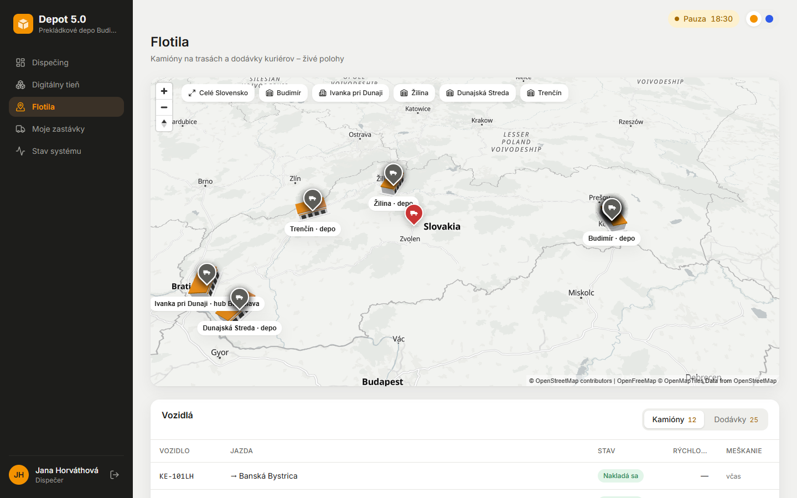
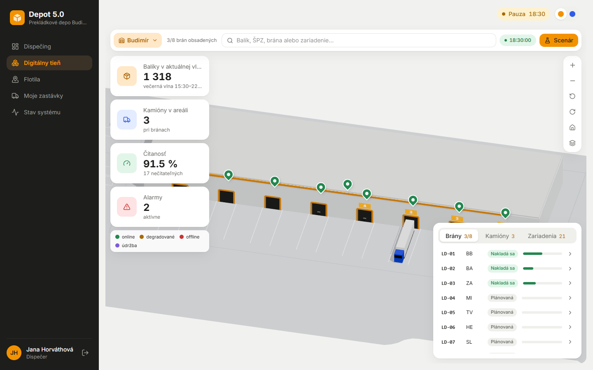
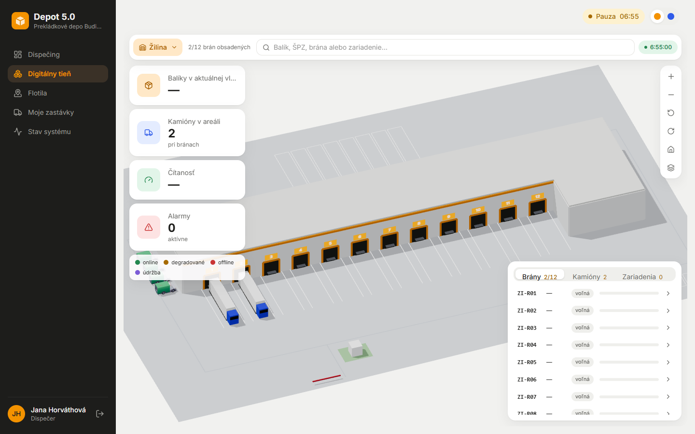
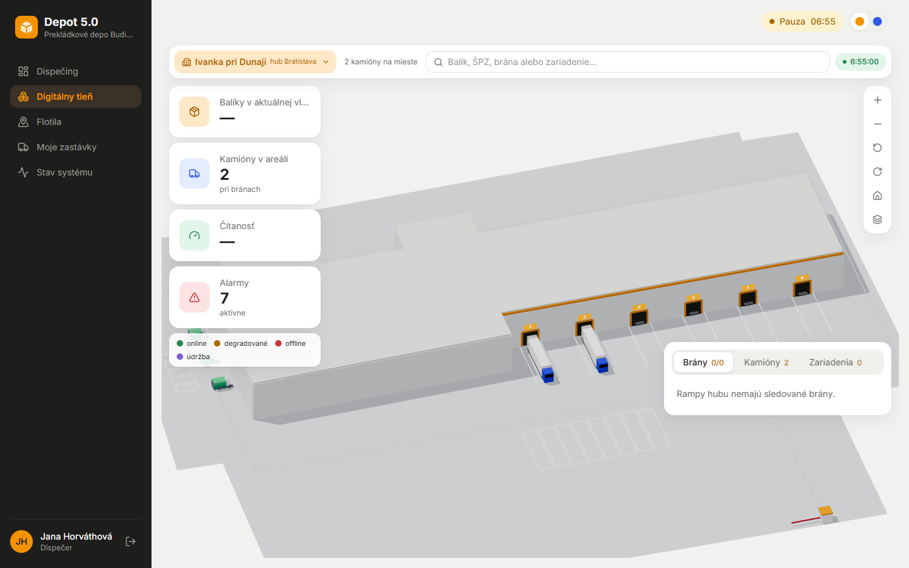
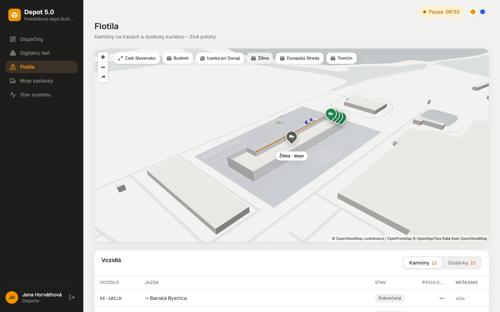
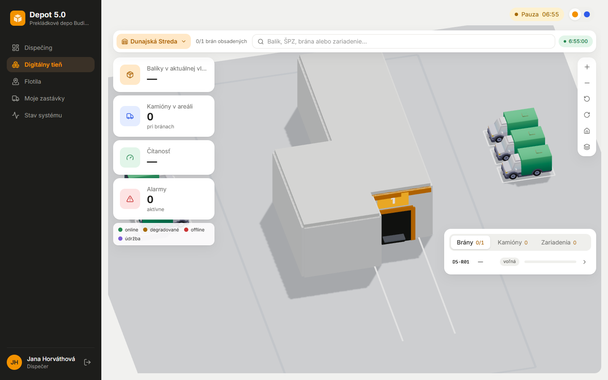

# Fáza 7c – Sklady: layouty z OSM, prevádzka Žiliny a Ivanky

> Pre koho: tím a príprava na obhajobe. Mapa a digitálny tieň majú skutočné layouty piatich skladov. Žilina a Ivanka majú vlastných kuriérov a bránu. Dunajská Streda a Trenčín sú zatiaľ len layout so zaparkovanými dodávkami. Rozhodnutia sú v ADR-064 (layouty), ADR-065 (Žilina) a ADR-066 (Ivanka, DS a TN).

## Čo vzniklo

| | |
| --- | --- |
|  |  |
| Flotila: 5 skladov s 3D halami, tlačidlá skladov nad mapou | Budimír vo večernej špičke (18:30): kamióny pri bránach, KPI vlny |
|  |  |
| Žilina o 06:55: 12 rámp na západ k ulici SNP, oba kamióny ZA pri rampách, dodávky pri kuriérskych bránach, vrátnica na ostrovčeku | Ivanka (hub Bratislava) o 06:55: kamióny BA pri rampách, dodávky kuriérov na severnom konci |
|  |  |
| Flotila priblížená na Žilinu: areál, hala a dodávky z layoutu | Dunajská Streda: len layout, 3 + 3 dodávky zaparkované na oboch dlhých stranách |

1. **Layouty z OSM** (ADR-064):
   - hala a areál sú skutočná geometria z OpenStreetMap: `tools/osm/extract_depots.py` → `seed/data/depots_osm.json`,
   - rampy, kuriérske brány, vjazd, státia návesov a parkoviská dodávok dopočíta `seed/depots.py` z krátkych poznámok tímu (strana, počet, typ),
   - satelitné snímky tímu slúžili len na kontrolu strán a počtov, neprekresľovali sa,
   - budova sa nehádala: keď OSM nebolo jednoznačné, agent vypísal kandidátov a vybral tím,
   - layout je dáta v DB, `/api/layout?depot=…` z neho kreslí tieň aj 3D halu na mape. Krok seedu má verziu z hashu výsledku, takže existujúca DB skončí rovnako ako čistá (test).
2. **Žilina v plnej prevádzke** (ADR-065):
   - balíky smeru ZA idú večer kamiónom z Budimíra do skladu Žilina (už nie do bodu mesta),
   - ráno ich rozvezú 4 kuriéri Žiliny (`kurierza01`–`04`) v kvadrantoch okolo mesta,
   - kuriér mimo Budimíra naloží len balík, ktorý naozaj prišiel kamiónom. Ostatné ostali v Budimíri a sken vráti 409 s vysvetlením.
3. **Ivanka v plnej prevádzke** (ADR-066):
   - 3 kuriéri (`kurierba01`–`03`) rozvážajú balíky smeru BA podľa PSČ: Ružinov, Vrakuňa a Podunajské Biskupice; Nové Mesto, Rača a Vajnory; obce okresu Senec,
   - ostatné balíky Bratislavy ostávajú v hube, ich rozvoz sa nesimuluje.
4. **Brána každého skladu:**
   - prejazd má sklad (`gate_events.depot_id`), `/gate` filtruje podľa skladu,
   - Žilina a Ivanka majú vlastný mix prejazdov (kamióny, dodávky, občas neznáme auto) na vlastnom prúde náhody, rozhodujú pravidlá zo 7b.
5. **Dunajská Streda a Trenčín:** layout a dodávky zaparkované na parkovisku, bez kuriérov a jázd. Server posiela ich miesta s layoutom, lebo ich simulátor nevedie. Pri prevádzkovaných skladoch polohu vždy hlási telematika.
6. **Budimír sa nezmenil:** golden test porovná vstupy app aj výstup simulácie večernej špičky so stavom z tagu `pre-depots`.
7. **Na neskôr** ([plan-doplnky.md](../plan-doplnky.md), „Po odovzdaní“):
   - prevádzka Dunajskej Stredy a Trenčína (kuriéri, napájacie jazdy z Ivanky),
   - ulice ďalších miest v offline cestnej sieti (dovtedy dodávky mimo Košíc jazdia po hlavných cestách),
   - spresnenie Budimíra a Ivanky podľa satelitu a popisu, rozmery haly DS z merania.

## Ako to predviesť (3 minúty)

1. `dispecer` na `/fleet`: *Celé Slovensko* ukáže 5 skladov. Tlačidlo *Žilina* priblíži areál a halu z OSM.
2. *Admin → Simulácia → Situácie → Kuriéri ráno* (06:55). `/shadow`, rozbaľovací zoznam *Žilina*: kamióny ZA pri rampách, dodávky pri kuriérskych bránach. To isté pre *Ivanka pri Dunaji*.
3. `kurierza01` na `/courier`: nakládka pri ZI-SB01. Sken balíka, ktorý kamión nezobral, appka odmietne s vysvetlením.
4. `ochranka` na `/gate`: filter *Žilina* alebo *Ivanka pri Dunaji* ukáže prejazdy kamiónov a dodávok tej brány.
5. `/shadow?depot=DS`: Dunajská Streda len s layoutom a zaparkovanými dodávkami.

## Kde to je v kóde

| Čo | Súbor |
| --- | --- |
| Geometria z OSM, kandidáti | [tools/osm/extract_depots.py](../../tools/osm/extract_depots.py), [tools/osm/find_hub.py](../../tools/osm/find_hub.py), [tools/osm/depots.json](../../tools/osm/depots.json) |
| Výpočet layoutu (rampy, státia, parkoviská, pruhy) | [seed/depots.py](../../app/src/depotrack/seed/depots.py), krok seedu `seed_depot_layouts` v [seed/geo.py](../../app/src/depotrack/seed/geo.py) |
| Prevádzka skladov (rajóny, kuriéri, dodávky) | [seed/operations.py](../../app/src/depotrack/seed/operations.py), `SCHEMES` v [services/couriers.py](../../app/src/depotrack/services/couriers.py) |
| Trasa kuriéra so skladom, parkovaním a nakládkou | `_route_places` v [api/internal.py](../../app/src/depotrack/api/internal.py), `buildCourierSchedules` v [telematics/src/simulator/couriers.ts](../../telematics/src/simulator/couriers.ts) |
| Brána skladu | `depotGateMix` v [telematics/src/simulator/gatemix.ts](../../telematics/src/simulator/gatemix.ts), [api/gate.py](../../app/src/depotrack/api/gate.py) (`?depot=`) |
| Tieň a mapa | [frontend/src/shadow/](../../frontend/src/shadow/) (`parts.ts`, `ShadowScene.tsx`, `CourierVans.tsx`), [pages/FleetPage.tsx](../../frontend/src/pages/FleetPage.tsx), [components/map/depot3d.ts](../../frontend/src/components/map/depot3d.ts) |
| Testy | `app/tests/test_depots.py`, `test_delivery.py` (Žilina, Ivanka), `test_golden_bud.py`, `telematics/tests/depots.test.ts`, `golden.test.ts` |

## Prečo je to tak navrhnuté

- **Prečo layout ako dáta, nie model v kóde?** Ten istý layout kreslí tieň aj mapu a nový sklad je len nový záznam. Tím ho opraví v poznámkach (strana, počet rámp) bez zásahu do scény.
- **Prečo kuriéri Žiliny rozvážajú balíky ZA a nevznikajú nové balíky?** Smer ZA už existoval a balíky naň chodili z Budimíra. Prevádzka Žiliny tak nadväzuje na reálny tok a Budimír ostáva rovnaký.
- **Prečo rajóny Ivanky podľa PSČ?** „Bratislava-východ“ a „Senec“ sú správne celky. Kvadranty okolo stredu mesta by ich nevystihli.
- **Prečo DS a TN bez prevádzky?** Rozhodnutie tímu kvôli termínu odovzdania. Radšej menej, ale overené. Zaparkované dodávky sú len pri skladoch, ktoré simulátor nevedie, aby tieň nikde nepredstieral stav, ktorý nehlási telematika.
- **Ako viete, že sa Budimír nezmenil?** Golden test z tagu `pre-depots`: rovnaké vstupy app, rovnaké skeny, jazdy, prejazdy a alarmy večernej špičky. Nové náhodné rozhodnutia majú vlastné prúdy `rngFor(seed, deň, "gate-mix", sklad)`.

## Možné otázky na obhajobe

- *Odkiaľ viete, kde sú rampy?* Hala a areál sú z OSM. Strany a počty rámp sú z poznámok tímu podľa satelitu, predpoklady sú v layoute (`source.assumed`) a v ADR-064.
- *Čo keď balík do Žiliny nestihol kamión?* Ostáva v Budimíri, kuriér Žiliny ho nenaloží (409 s vysvetlením v appke). Test `test_zilina_couriers_deliver_the_parcels_of_the_za_truck`.
- *Prečo dodávky Žiliny jazdia rovnými čiarami?* Offline cestná sieť má ulice len okolo Košíc. Rozšírenie je v pláne, za behu sa nič zo siete nesťahuje.
- *Je to stále digitálny tieň?* Áno. Scéna len zrkadlí stav zo simulátora a WMS, do sveta zasahuje človek cez bežné obrazovky (ADR-045).
