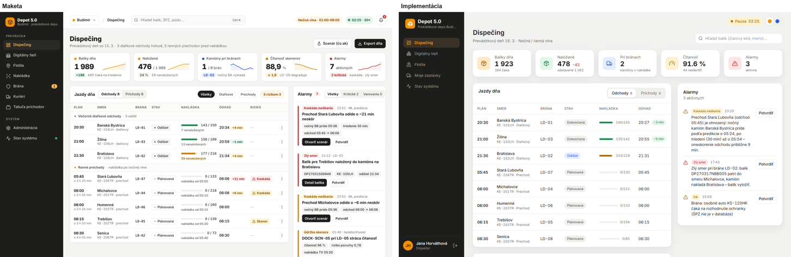
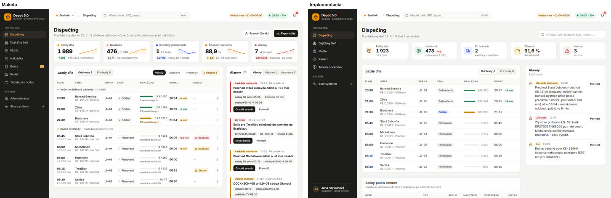
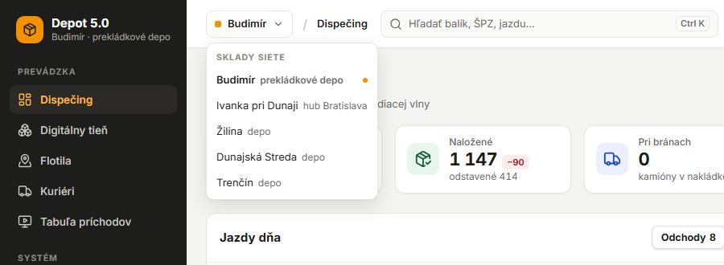

# Fáza 7d – UI/UX v2: porovnanie s maketami

> Pre koho: tím a reviewer. Pre každú obrazovku s maketou je tu tabuľka **položka | maketa | pred | čo sa zmenilo | stav** a screenshot vedľa makety. Stav ✓ znamená, že screenshot zodpovedá makete, ✗ nie. Obrazovka ide do commitu, až keď sú všetky položky ✓. Screenshoty sú v rovnakom stave ako maketa: dispečing v situácii `night-cascade` o 02:25 pri 30×, tieň v `evening-peak` okolo 18:40.

Makety: [dispečing a design systém v2](../design/maketa-dispecing/README.md), [login](../design/maketa-login/), [digitálny tieň](../design/maketa-tien/README.md). Rozhodnutia: ADR-067 (design systém v2).

## Krok 1 – design systém v2 a shell (bočná lišta, horná lišta)

Porovnáva sa rám aplikácie z makety dispečingu (obsah dispečingu je krok 4). Prihlásený dispečer Jana Horváthová (ranná zmena), Budimír, 1440 px.

| Položka | Maketa | Pred | Čo sa zmenilo | Stav |
| --- | --- | --- | --- | --- |
| Pozadie stránky | `#f4f4f2` | `#f1f1ef` | token `canvas` | ✓ |
| Karty | biele, okraj 1 px `#e7e6e2`, radius 12, tieň `0 1px 2px` | bez okraja, radius 16, výrazný tieň | `Card`, `KpiCard`, tokeny `line`, `radius-card`, `shadow-card` | ✓ |
| Nadpis stránky | 24/800, kontext 13 px sivý | 24/600 | `PageHeader` | ✓ |
| Primárne tlačidlo | čierne s bielym textom, oranžová len zvýraznenie | oranžové | `Button` `primary` čierne, nový variant `brand` | ✓ |
| Formát čísel | `88,9 %`, `1 989` | `91.6 %` | `lib/format.ts` na všetkých obrazovkách, žiadne `toFixed` | ✓ |
| Bočná lišta | 232 px, čierna, logo + „Budimír · prekládkové depo“ | 240 px, „Prekládkové depo Budimír“ natvrdo | `Sidebar`, sklad a jeho typ z `/api/depots` | ✓ |
| Sekcie navigácie | PREVÁDZKA / SYSTÉM, položky 36 px, aktívna `#2c2a26` s oranžovým textom | jeden zoznam | sekcie, výšky a farby podľa makety | ✓ |
| Položky | Dispečing, Digitálny tieň, Flotila, Nakládka, Brána (odznak), Kuriéri, Tabuľa príchodov, Administrácia, Stav systému (bodka) | bez Tabule, odznaku a bodky, „Moje zastávky“ | Tabuľa príchodov (odkaz s kľúčom z `/api/shell`), odznak frontu brány, bodka spojenia, „Kuriéri“. Položky podľa role (ADR-017): dispečer nevidí Nakládku, Bránu a Administráciu, administrátor vidí všetky ako v makete | ✓ |
| Účet dole | avatar s iniciálami, meno, „Dispečer · nočná zmena“ | meno + rola, ikona odhlásenia | rola so zmenou, menu účtu (téma, odhlásenie) | ✓ |
| Horná lišta | 60 px, biela, okraj dole | žiadna (len hodiny a téma vpravo hore) | `AppHeader` | ✓ |
| Sklad v hornej lište | „Budimír“ s oranžovým štvorčekom | – | zobrazenie skladu (prepínanie skladov je krok 2) | ✓ |
| Drobčeky | „/ Dispečing“ | – | názov stránky z navigácie | ✓ |
| Hľadanie | „Hľadať balík, ŠPZ, jazdu…“, `Ctrl K` | len na dispečingu, iný vzhľad | pole v hornej lište, Ctrl K / ⌘K, výsledky balíkov (ŠPZ a jazdy so skladom a rolou v kroku 2) | ✓ |
| Vlna | „Nočná vlna · 01:00–06:00“ oranžová pilulka | – | z `/api/shell` | ✓ |
| Čas | zelená pilulka „02:25 · 30ד | „Live 02:25“ | čas a rýchlosť, pauza jantárová, bez spojenia sivá „offline“ | ✓ |
| Alarmy | zvonček s červeným počtom | – | počet z `/api/shell`, zoznam alarmov dňa v popoveri (`/api/alerts?current=true`) | ✓ |
| Digitálny tieň | navigácia zbalená na 72 px, bez hornej lišty aplikácie | 240 px navigácia + riadok s hodinami | zbalená lišta s tooltipmi, tieň má vlastnú lištu (krok 5) | ✓ |
| Telefón (390 px) | (maketa navigáciu skrýva) | navigácia hore | riadok navigácie pod logom, horná lišta so skladom, časom a alarmami, bez vodorovného posúvania | ✓ |

Kontrola ďalších šírok: 1280 px a 390 px bez vodorovného posúvania (skript screenshotov meria `scrollWidth`).

## Krok 2 – sieť skladov (prepínač skladu, ADR-068)

Maketa ukazuje v hornej lište sklad so šípkou (prepínač). Prihlásený dispečer, 1440 px.

| Položka | Maketa | Pred | Čo sa zmenilo | Stav |
| --- | --- | --- | --- | --- |
| Prepínač skladu | „Budimír ▾“ v hornej lište | sklad bez prepínania (krok 1), v tieni vlastný zoznam všetkých skladov | menu „Sklady siete“ s typom skladu z dát. Len pre dispečera a administrátora, ochranka, operátor a kuriér vidia svoj sklad bez menu. Výber je v adrese a pamätá sa | ✓ |
| Sklad v bočnej lište | „Budimír · prekládkové depo“ | podľa adresy, inak Budimír natvrdo | zvolený sklad a jeho typ (`Žilina · depo`, `Ivanka pri Dunaji · hub Bratislava`) | ✓ |
| Hľadanie | v rámci skladu | balíky celej siete | `/api/search` v zvolenom sklade podľa roly | ✓ |

Poistky po kroku 2: golden test Budimíra prechádza, demo scenáre z `docs/demo.md` prejdené v prehliadači ako administrátor, dispečer, operátor, ochranka a kuriéri Budimíra a Žiliny (večerná špička aj ranní kuriéri): všetky obrazovky bez chýb v konzole, bez chybových odpovedí API a bez vodorovného posúvania.
