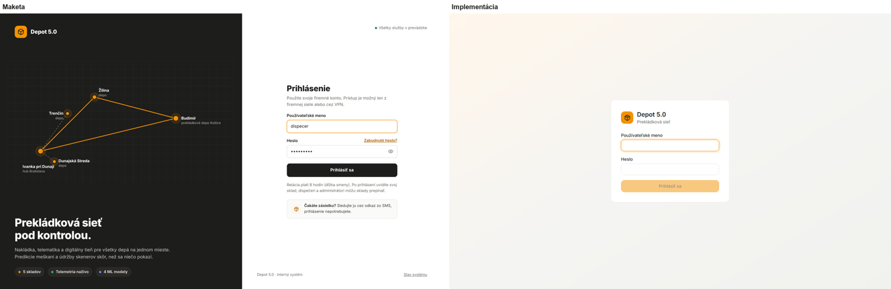
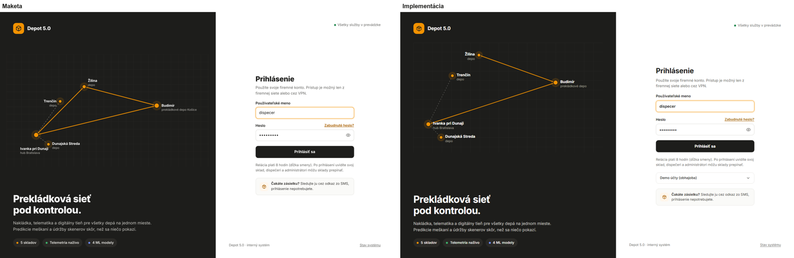
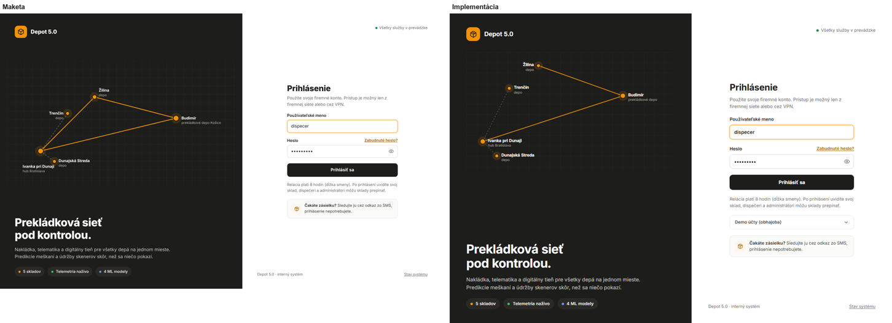
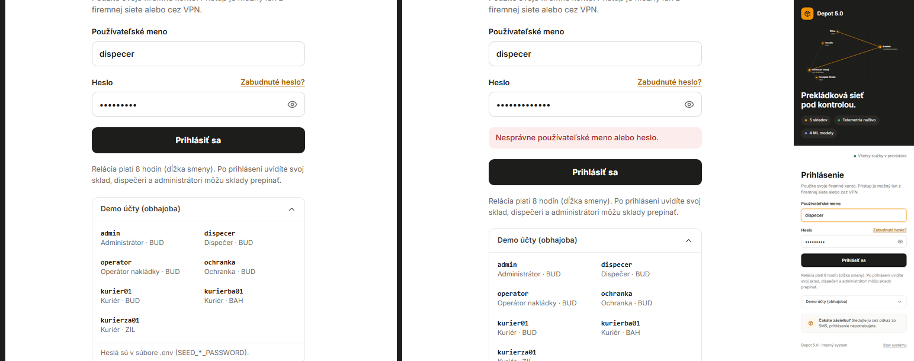
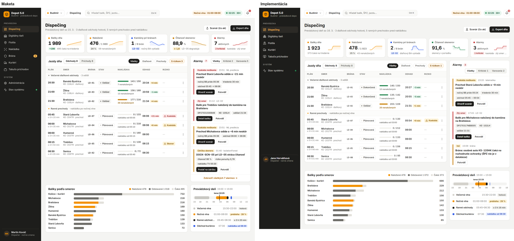
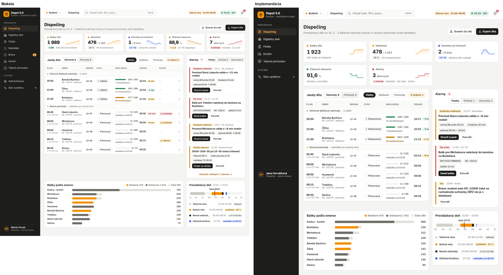
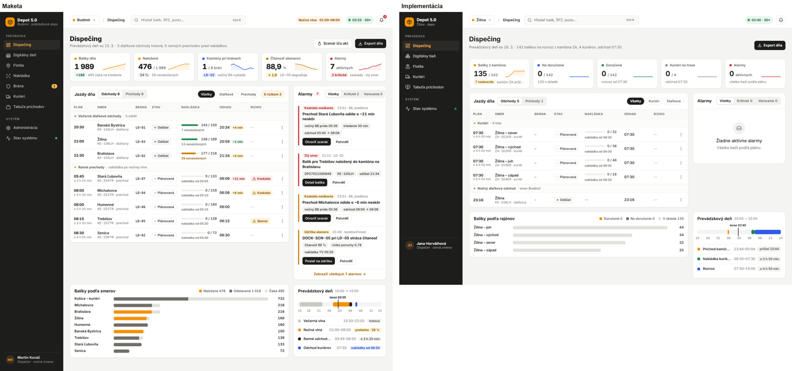
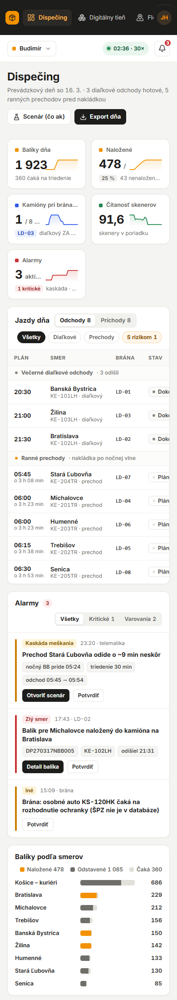

# Fáza 7d – UI/UX v2: porovnanie s maketami

> Pre koho: tím a reviewer. Pre každú obrazovku s maketou je tu tabuľka **položka | maketa | pred | čo sa zmenilo | stav** a screenshot vedľa makety. Stav ✓ znamená, že screenshot zodpovedá makete, ✗ nie. Obrazovka ide do commitu, až keď sú všetky položky ✓. Screenshoty sú v rovnakom stave ako maketa: dispečing v situácii `night-cascade` o 02:25 pri 30×, tieň v `evening-peak` okolo 18:40.

Makety: [dispečing a design systém v2](../design/maketa-dispecing/README.md), [login](../design/maketa-login/), [digitálny tieň](../design/maketa-tien/README.md). Rozhodnutia: ADR-067 (design systém v2).

## Krok 1 – design systém v2 a shell (bočná lišta, horná lišta)

Porovnáva sa rám aplikácie z makety dispečingu (obsah dispečingu je krok 4). Prihlásený dispečer Jana Horváthová (ranná zmena), Budimír, 1440 px.

| Položka | Maketa | Pred | Čo sa zmenilo | Stav |
| --- | --- | --- | --- | --- |
| Pozadie stránky | `#f4f4f2` | `#f1f1ef` | token `canvas` | ✓ |
| Karty | biele, okraj 1 px `#e7e6e2`, radius 12, tieň `0 1px 2px` | bez okraja, radius 16, výrazný tieň | `Card`, `KpiCard`, tokeny `line`, `radius-card`, `shadow-card` | ✓ |
| Nadpis stránky | 24/800, kontext 13 px sivý | 24/600 | `PageHeader` | ✓ |
| Primárne tlačidlo | čierne s bielym textom, oranžová len zvýraznenie | oranžové | `Button` `primary` čierne, nový variant `brand` | ✓ |
| Formát čísel | `88,9 %`, `1 989` | `91.6 %` | `lib/format.ts` na všetkých obrazovkách, žiadne `toFixed` | ✓ |
| Bočná lišta | 232 px, čierna, logo + „Budimír · prekládkové depo“ | 240 px, „Prekládkové depo Budimír“ natvrdo | `Sidebar`, sklad a jeho typ z `/api/depots` | ✓ |
| Sekcie navigácie | PREVÁDZKA / SYSTÉM, položky 36 px, aktívna `#2c2a26` s oranžovým textom | jeden zoznam | sekcie, výšky a farby podľa makety | ✓ |
| Položky | Dispečing, Digitálny tieň, Flotila, Nakládka, Brána (odznak), Kuriéri, Tabuľa príchodov, Administrácia, Stav systému (bodka) | bez Tabule, odznaku a bodky, „Moje zastávky“ | Tabuľa príchodov (odkaz s kľúčom z `/api/shell`), odznak frontu brány, bodka spojenia, „Kuriéri“. Položky podľa role (ADR-017): dispečer nevidí Nakládku, Bránu a Administráciu, administrátor vidí všetky ako v makete | ✓ |
| Účet dole | avatar s iniciálami, meno, „Dispečer · nočná zmena“ | meno + rola, ikona odhlásenia | rola so zmenou, menu účtu (téma, odhlásenie) | ✓ |
| Horná lišta | 60 px, biela, okraj dole | žiadna (len hodiny a téma vpravo hore) | `AppHeader` | ✓ |
| Sklad v hornej lište | „Budimír“ s oranžovým štvorčekom | – | zobrazenie skladu (prepínanie skladov je krok 2) | ✓ |
| Drobčeky | „/ Dispečing“ | – | názov stránky z navigácie | ✓ |
| Hľadanie | „Hľadať balík, ŠPZ, jazdu…“, `Ctrl K` | len na dispečingu, iný vzhľad | pole v hornej lište, Ctrl K / ⌘K, výsledky balíkov (ŠPZ a jazdy so skladom a rolou v kroku 2) | ✓ |
| Vlna | „Nočná vlna · 01:00–06:00“ oranžová pilulka | – | z `/api/shell` | ✓ |
| Čas | zelená pilulka „02:25 · 30ד | „Live 02:25“ | čas a rýchlosť, pauza jantárová, bez spojenia sivá „offline“ | ✓ |
| Alarmy | zvonček s červeným počtom | – | počet z `/api/shell`, zoznam alarmov dňa v popoveri (`/api/alerts?current=true`) | ✓ |
| Digitálny tieň | navigácia zbalená na 72 px, bez hornej lišty aplikácie | 240 px navigácia + riadok s hodinami | zbalená lišta s tooltipmi, tieň má vlastnú lištu (krok 5) | ✓ |
| Telefón (390 px) | (maketa navigáciu skrýva) | navigácia hore | riadok navigácie pod logom, horná lišta so skladom, časom a alarmami, bez vodorovného posúvania | ✓ |

Kontrola ďalších šírok: 1280 px a 390 px bez vodorovného posúvania (skript screenshotov meria `scrollWidth`).

## Krok 2 – sieť skladov (prepínač skladu, ADR-068)

Maketa ukazuje v hornej lište sklad so šípkou (prepínač). Prihlásený dispečer, 1440 px.

| Položka | Maketa | Pred | Čo sa zmenilo | Stav |
| --- | --- | --- | --- | --- |
| Prepínač skladu | „Budimír ▾“ v hornej lište | sklad bez prepínania (krok 1), v tieni vlastný zoznam všetkých skladov | menu „Sklady siete“ s typom skladu z dát. Len pre dispečera a administrátora, ochranka, operátor a kuriér vidia svoj sklad bez menu. Výber je v adrese a pamätá sa | ✓ |
| Sklad v bočnej lište | „Budimír · prekládkové depo“ | podľa adresy, inak Budimír natvrdo | zvolený sklad a jeho typ (`Žilina · depo`, `Ivanka pri Dunaji · hub Bratislava`) | ✓ |
| Hľadanie | v rámci skladu | balíky celej siete | `/api/search` v zvolenom sklade podľa roly | ✓ |

Poistky po kroku 2: golden test Budimíra prechádza, demo scenáre z `docs/demo.md` prejdené v prehliadači ako administrátor, dispečer, operátor, ochranka a kuriéri Budimíra a Žiliny (večerná špička aj ranní kuriéri): všetky obrazovky bez chýb v konzole, bez chybových odpovedí API a bez vodorovného posúvania.

## Krok 3 – login (maketa-login)

Bez prihlásenia, demo režim (`SIM_CONTROLS_ENABLED=true`), 1440 px. Formulár vyplnený ako v makete (meno „dispecer“, fokus na mene).

| Položka | Maketa | Pred | Čo sa zmenilo | Stav |
| --- | --- | --- | --- | --- |
| Rozloženie | tmavý panel vľavo (1,25 : 1), biely formulár vpravo | malá karta v strede na farebnom pozadí | dva panely, pod 768 px pod sebou | ✓ |
| Logo | oranžový štvorec, „Depot 5.0“ 18/800 | logo a „Prekládková sieť“ | podľa makety | ✓ |
| Schéma siete | 5 skladov s halo, názov + typ, plné spojenia, prerušované napájanie, mriežka | – | `NetworkMap` z `/api/public/login-info`: polohy z DB, plné čiary = diaľkové smery do iného skladu (Budimír → Ivanka, Budimír → Žilina), prerušované = plánované napájanie skladov bez prevádzky z hubu (Ivanka → Dunajská Streda, Trenčín). Štítky sa vyhýbajú čiaram aj sebe. **Rozdiel v obsahu, nie v dizajne:** maketa má navyše čiaru Ivanka–Žilina a „prekládkové depo Košice“; v dátach taký smer ani mesto skladu nie je, schéma kreslí len dáta (zadanie „z /api/depots, nie natvrdo“) | ✓ |
| Nadpis a text | „Prekládková sieť pod kontrolou.“ 36/800, popis 15 px | – | podľa makety | ✓ |
| Pilulky | 5 skladov · Telemetria naživo · 4 ML modely | – | z dát: počet skladov, spojenie s telematikou, načítané modely (meškanie, brána YOLOX + OCR, skenery) | ✓ |
| Stav služieb | „● Všetky služby v prevádzke“ vpravo hore | – | DB a telematika; pri výpadku jantárové „Niektoré služby nebežia“ | ✓ |
| Formulár | nadpis 26/800, polia 42 px radius 9, fokus oranžový prstenec | polia 38 px, oranžové tlačidlo | podľa makety | ✓ |
| Zobrazenie hesla | ikona oka v poli | – | prepínač zobraziť / skryť (`aria-pressed`) | ✓ |
| Zabudnuté heslo | odkaz vpravo nad heslom | – | vysvetlenie v popoveri: heslo obnoví administrátor (žiadny falošný formulár) | ✓ |
| Tlačidlo | čierne 44 px | oranžové | čierne, pri neúplných údajoch neaktívne | ✓ |
| Chybové stavy | – | 401, 403, 429 | zlé údaje (401), zablokovaný účet (403), veľa pokusov (429), nedostupný server, nevyplnené údaje | ✓ |
| Info o smene | „Relácia platí 8 hodín…“ | – | dĺžka relácie z nastavení servera | ✓ |
| Sledovanie zásielky | box „Čakáte zásielku?“ | – | podľa makety | ✓ |
| Demo účty | (nie je v makete, požiadavka tímu) | – | rozbaľovací blok pod formulárom len v demo režime: mená, roly a sklad, klik vyplní meno. Heslá API nikdy neposiela (test) | ✓ |
| Pätka | „Depot 5.0 · interný systém“, „Stav systému“ | – | stav WMS, telematiky a modelov v popoveri | ✓ |
| Telefón (390 px) | (panel nad formulárom, výška 360 px) | – | panel so schémou nad formulárom, bez vodorovného posúvania | ✓ |

## Krok 4 – dispečing (maketa-dispecing)

Situácia `night-cascade` o 02:25 pri 30× (ako maketa), Budimír, dispečer, 1440 px.

| Položka | Maketa | Pred | Čo sa zmenilo | Stav |
| --- | --- | --- | --- | --- |
| Nadpis a akcie | „Dispečing“, „Prevádzkový deň so 15. 3. · 3 diaľkové odchody hotové, 5 ranných prechodov pred nakládkou“, Scenár (čo ak), Export dňa | nadpis, vlna, vyhľadávanie balíka | súhrn dňa z dát, „Scenár (čo ak)“ otvorí scenár v tieni, „Export dňa“ stiahne CSV jázd | ✓ |
| KPI | 5 kariet v riadku: značka, číslo s jednotkou, sparkline, zmena + kontext | 5 kariet s pastelovými ikonami bez histórie | `GET /api/dispatch`: história každých 30 min od 15:00 (balíky, naložené, kamióny pri bránach, čítanosť za poslednú hodinu, otvorené alarmy), zmena a kontext z dát (`+N` za hodinu, `25 %`, `LD-02`, „diaľkový BA vykladá“, `1 kritické`). 3 karty v riadku do 1280 px, 2 na telefóne | ✓ |
| Jazdy dňa | taby Odchody / Príchody, filtre Všetky / Diaľkové / Prechody / S rizikom N | taby, bez filtrov a skupín | `SegmentedTabs`, `FilterChips`, filtre podľa typov v dátach | ✓ |
| Skupiny jázd | „Večerné diaľkové odchody · 3 odišli“, „Ranné prechody · nakládka po nočnej vlne“ | jeden zoznam | skupiny so záhlavím a bodkou | ✓ |
| Riadok jazdy | 52 px: plán + „o 3 h 20 min“, smer + ŠPZ · typ, brána, stav, nakládka (pruh, „7 nenaložených“ / „nakládka od 05:05“), odhad + odchýlka, riziko, ⋮ | 61 px, bez rizika a akcií | `DataTable` v2. Pri kamiónoch „pri bráne od“ = plánovaný príchod k bráne (03:00, v makete ilustračné „nakládka od 05:05“, odchýlku tím schválil: dáta majú prednosť), pri kuriéroch „nakládka od 06:30“. Odhad prechodu z kaskády nočných kamiónov (predikcia ML + triedenie), riziko „Kaskáda“ / „Skener“ (skener brány nad prahom modelu). ⋮: tieň, Flotila | ✓ |
| Alarmy | štruktúra: typ, čas · zdroj, nadpis jednou vetou, fakty ako čipy, akcia + Potvrdiť, filtre Všetky / Kritické / Varovania, „Zobraziť všetkých“ | odsek textu a Potvrdiť | `AlertItem`, nadpis a fakty z dát, na ktoré alarm odkazuje (kaskáda: nočný kamión, triedenie, odchod → odhad; zlý smer: balík, kamión, odchod; skener: čítanosť, riziko, ďalšia nakládka). Akcie: Otvoriť scenár, Detail balíka, Poslať na údržbu, Potvrdiť | ✓ |
| Balíky podľa smerov | skladané pruhy naložené / odstavené / čaká, legenda so súčtami, kuriérske rajóny mesta v jednom riadku | tabuľka | `StackedBar`, „Košice – kuriéri“ spája rajóny | ✓ |
| Prevádzkový deň | os 15:00 → 15:00 so značkou „teraz“, vlny, ranné odchody, odchod kuriérov so stavmi | – | `DayTimeline`: vlny skladu z DB (hotová / prebieha · 29 % / o …), ranné odchody (prvý–posledný prechod), odchod kuriérov 07:30 „nakládka od 06:30“ | ✓ |
| Rozloženie | plná šírka, hlavný stĺpec + 340 px | úzky stĺpec v strede | mriežka podľa makety, pod 1100 px jeden stĺpec, na telefóne bez vodorovného posúvania | ✓ |
| Depo bez triedenia (Žilina, Ivanka) | (požiadavka tímu) | rovnaké karty ako Budimír s nulami | rovnaký layout s obsahom depa: KPI Balíky z kamióna, Na doručenie, Doručené, Kuriéri na trase, Alarmy. Jazdy: kuriéri, nočný odchod, diaľkový kamión (príchod podľa brány skladu). Balíky podľa rajónov (doručené / na doručenie / v sklade). Časová os: príchod kamióna, nakládka kuriérov 06:30, rozvoz, večerný odchod. Žiadne vlny (ani v hornej lište) ani triedenie | ✓ |

Rozdiely v číslach oproti makete sú dané stavom simulácie (iný deň, iné meškania). Rozloženie, komponenty a typy údajov sedia.

